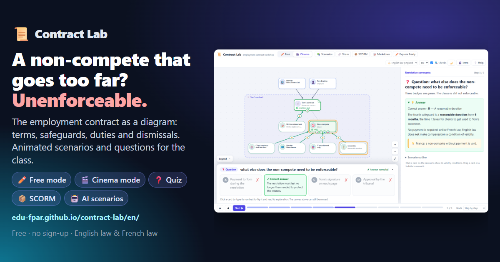
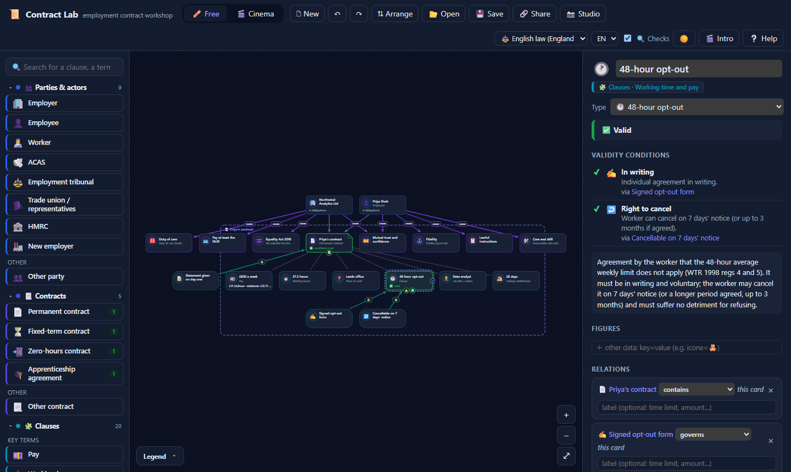
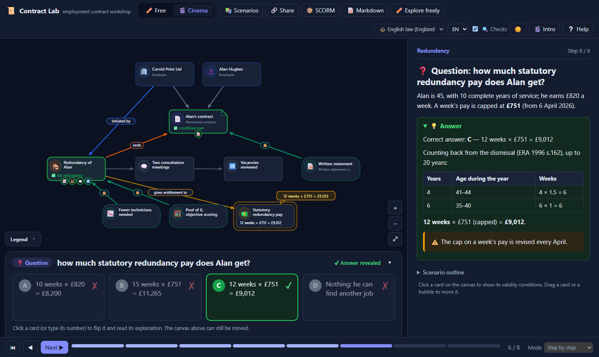
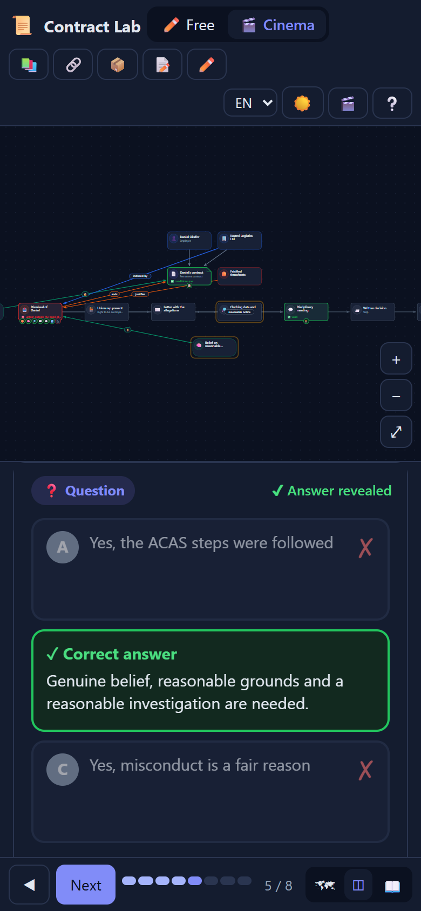

# Contract Lab — employment contract workshop

[](https://doi.org/10.5281/zenodo.24508195)
Source code: [github.com/edu-fpar/contract-lab](https://github.com/edu-fpar/contract-lab)

[Français](README.md) · 🇬🇧 **English** · 🇪🇸 [Español](README.es.md)

[](https://edu-fpar.github.io/contract-lab/en/?scenario=uk-covenants&etape=5)

**Contract Lab** is a browser-only teaching tool to visualise and explain the **contract of employment** and **employment law**:
a contract and its **terms** as icons, the **safeguards** that make them valid or enforceable, the **incompatibilities**,
the parties' **duties**, **dismissals and terminations** with their procedure, and the **payments** they open.
The tool checks each item and shows a verdict: ✅ valid, ⚠️ at risk, ⛔ void, unfair or unenforceable, ⚡ duty breached.

**▶ Online: [edu-fpar.github.io/contract-lab/en/](https://edu-fpar.github.io/contract-lab/en/)** (also on a phone) ·
🎬 [guided video tour](https://edu-fpar.github.io/contract-lab/intro.html?lang=en) ·
📖 [documentation in English](https://edu-fpar.github.io/contract-lab/docs/#/en/)

**Three languages, three laws**: English (English law, England & Wales, or French law in English), French (French law) and Spanish (Spanish law). Language: selector in the toolbar, or `?lang=en`. Law: selector in the toolbar, or `droit: uk` at the top of a scenario. Terms, safeguards, calculations and scenarios follow the chosen law.

No installation: open `index.html` (double-click) or serve the folder with any web server, then add `?lang=en`. No external dependency, works offline.

## Two modes

- **✏️ Free**: palette of items by family (parties, contracts, terms, safeguards, duties, misconduct, dismissals, procedure, payments, sources of law), with search;
  links drawn from the `+` handle; automatic checks (conditions of validity, incompatibilities, notice and payment calculations). The **badges** under a card are its
  safeguards; **＋** in the inspector adds a missing one. Untick **🔍 Checks** to hide the verdicts and let the class decide.
  **📸 Studio** captures commented steps and exports a markdown scenario; **🔗 Share** gives a link that contains the diagram.

  

- **🎬 Cinema**: plays a markdown scenario step by step or continuously, with **questions for the class** and a phone layout.
  Direct links: `?lang=en&scenario=uk-covenants&etape=5`, `?lang=en&scenarios`, or the 🔗 Share button.
  **📦 SCORM** exports the scenario as a package for Moodle or another LMS (completion, resume, score).

  

<p align="center"></p>

## Three laws

| Law | Content | Scenarios |
|---|---|---|
| 🇬🇧 **English law (England & Wales)** | employee and worker status, written statement of particulars, key terms, 48-hour opt-out, deductions from wages, restrictive covenants (legitimate interest and reasonableness, no payment needed), garden leave and PILON, unfair dismissal (misconduct, capability, redundancy: Burchell, ACAS Code, band of reasonable responses, Polkey), summary, wrongful and constructive dismissal, settlement agreements (ERA 1996 s.203). Calculations: qualifying period, statutory notice (s.86), notice pay, statutory redundancy pay and basic award (age bands, week's pay cap), compensatory award (Polkey, ACAS uplift, cap), minimum wage. Figures from 6 April 2026 as parameters; Employment Rights Act 2025 reforms flagged ⚠️ | 9: `uk-contract`, `uk-covenants`, `uk-probation-notice`, `uk-misconduct`, `uk-gross-misconduct`, `uk-redundancy`, `uk-settlement`, `uk-constructive`, `uk-quiz` (`js/library-uk.js`) |
| 🇫🇷 **French law** | CDI, CDD, probation, non-compete with financial compensation, mobility, exclusivity, dismissal for personal reasons, gross misconduct, mutual termination (rupture conventionnelle), resignation, prise d'acte; English labels when the interface is in English | 13, in English (`js/library-en.js`) and in French (`js/library.js`) |
| 🇪🇸 **Spanish law** | open-ended and temporary contracts (2021 reform), probation, non-compete, permanence and exclusivity pacts, working time, minimum wage (SMI), disciplinary, objective and collective dismissal, *improcedente* and void dismissal, resignation, art. 50 ET; severance of 20 / 33 / 12 days per year and their caps | 11, in Spanish (`js/library-es.js`) |

## Sharing

Each language has its own entry page, with its own preview on social networks (title, description, image):

| | Link | Preview |
|---|---|---|
| 🇬🇧 | https://edu-fpar.github.io/contract-lab/en/ | [visuels/en/og.png](visuels/en/og.png) |
| 🇫🇷 | https://edu-fpar.github.io/contract-lab/ | [visuels/fr/og.png](visuels/fr/og.png) |
| 🇪🇸 | https://edu-fpar.github.io/contract-lab/es/ | [visuels/es/og.png](visuels/es/og.png) |

The app's **🔗 Share** button builds these links (step, scenario, library, free-mode diagram) in the chosen language.
Ready-to-post visuals (square, portrait, story, screenshots) and post texts in three languages: [visuels/](visuels/README.md).

## Writing a scenario with an AI

Give any AI the instructions page [docs/en/instructions-ia.md](https://edu-fpar.github.io/contract-lab/docs/en/instructions-ia.md) with your course,
or use the Claude skill `skill/scenario-contract-lab.skill`, which replays the scenario with the real engine
(`node skill/scenario-contract-lab/scripts/verifier.js scenario.md --lang en`). Format: [docs/en/format-scenario.md](docs/en/format-scenario.md).

````markdown
---
droit: uk
---
# My scenario
> Short description.

## 1. First step
Commentary in **markdown**.

```scene
employer EMP "Hartley Recruitment Ltd"
employee TOM "Tom" service=3 weekly_pay=650
permanent CT "Tom's contract"
EMP TOM -> CT
non_compete NC "Non-compete"
CT -> NC
focus NC
```
````

## Documentation and tools

- Documentation: [English](https://edu-fpar.github.io/contract-lab/docs/#/en/), [French](https://edu-fpar.github.io/contract-lab/docs/), [Spanish](https://edu-fpar.github.io/contract-lab/docs/#/es/) (Docsify; the pages are plain markdown in `docs/en/`, `docs/`, `docs/es/`).
- After changing the engine, the catalogues or the scenarios: `node tools/build.js`, then `python tools/package_skill.py`.
- Untranslated interface strings: `node tools/i18n-check.js`.
- Documentation screenshots and visuals: `node tools/screenshots.js` (headless Edge or Chrome, no dependency); see [visuels/README.md](visuels/README.md).

## Credits

Contract Lab reuses the scenario engine of **Capital Lab**, which grew out of the tool devised by **Tao** to show his financial law class how a company
can be controlled by a minority shareholder, and passed on by **Yannick**. Many thanks to them.

## License and citation

© 2026 François Parlant — [CC BY-NC-SA 4.0](https://creativecommons.org/licenses/by-nc-sa/4.0/). Using it in class or in training is free, with credit to the author; adaptations must be shared under the same license. See [LICENSE](LICENSE).

**Commercial use** (training company, publisher, white label, custom scenarios, tailored SCORM packages): a commercial license is available by agreement. [Get in touch](https://edu-fpar.github.io/about.html?lang=en).

**How to cite** (GitHub's *Cite this repository* button, from [CITATION.cff](CITATION.cff)):

> Parlant, F. (2026). *Contract Lab* [Educational software]. Zenodo. https://doi.org/10.5281/zenodo.24508195

Using it in class? [Let me know](https://www.linkedin.com/in/francois-parlant/): this feedback helps me improve the tool and spread the word.
