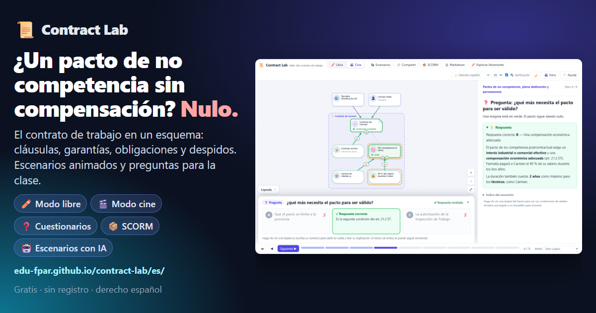
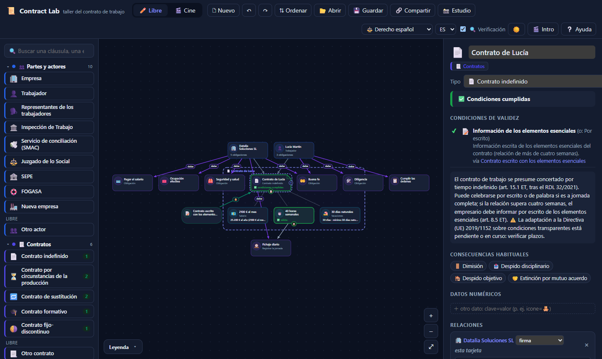
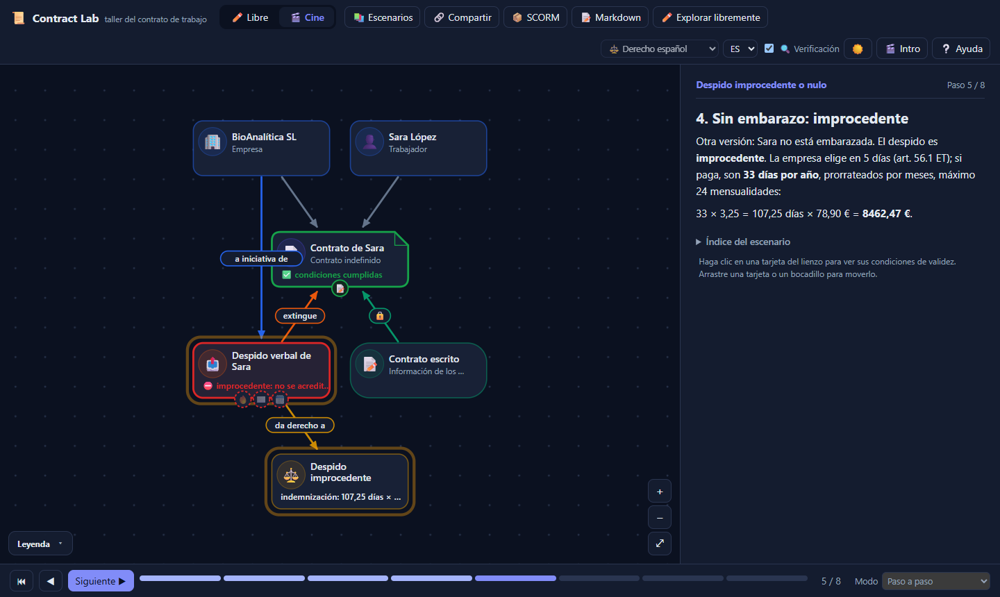
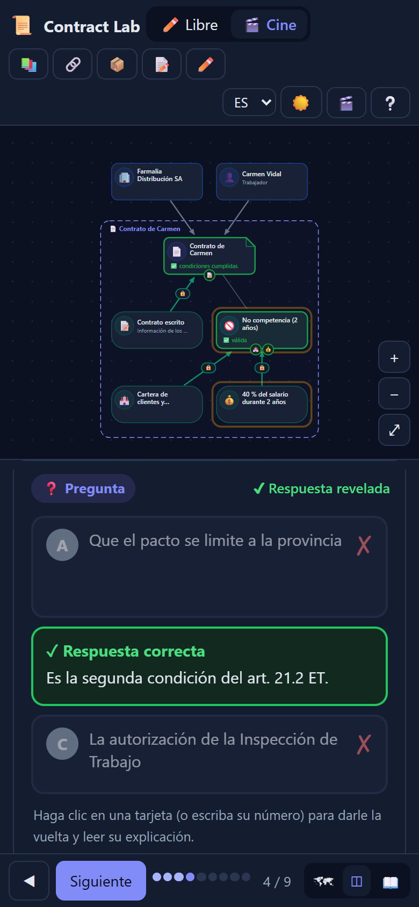

# Contract Lab — taller del contrato de trabajo

[](https://doi.org/10.5281/zenodo.24508195)
Código fuente: [github.com/edu-fpar/contract-lab](https://github.com/edu-fpar/contract-lab)

[Français](README.md) · 🇬🇧 [English](README.en.md) · 🇪🇸 **Español**

[](https://edu-fpar.github.io/contract-lab/es/?scenario=es-no-competencia&etape=4)

Herramienta didáctica para visualizar y explicar el **contrato de trabajo** y el **derecho del trabajo**:
un contrato y sus **cláusulas** en iconos, las **garantías** que las hacen válidas, las **incompatibilidades**,
las **obligaciones** de las partes, los **despidos y extinciones** con su procedimiento y las **indemnizaciones** a las que dan derecho.
La herramienta comprueba cada elemento y muestra un veredicto: ✅ válido, ⚠️ con riesgo, ⛔ nulo o improcedente, ⚡ obligación incumplida.

**▶ En línea: [edu-fpar.github.io/contract-lab/es/](https://edu-fpar.github.io/contract-lab/es/)** (también en el móvil) ·
🎬 [visita guiada en vídeo](https://edu-fpar.github.io/contract-lab/intro.html?lang=es) ·
📖 [documentación en español](https://edu-fpar.github.io/contract-lab/docs/#/es/)

**Tres idiomas, tres derechos**: español (derecho español: Estatuto de los Trabajadores tras la reforma laboral de 2021), francés (derecho francés) e inglés (derecho inglés, Inglaterra y Gales). Idioma: selector de la barra de herramientas, o `?lang=es`. Derecho: selector de la barra de herramientas, o `droit: es` al principio de un escenario. Las cláusulas, garantías, cálculos y escenarios siguen el derecho elegido.

Sin instalación: abra `index.html` (doble clic) o sirva la carpeta con cualquier servidor web y añada `?lang=es`. Sin dependencias externas, funciona sin conexión.

## Dos modos

- **✏️ Libre**: paleta de elementos por familias (partes, contratos, cláusulas, garantías, obligaciones, incumplimientos, extinciones, trámites, indemnizaciones, normas),
  con buscador; vínculos trazados desde el asa `+`; comprobación automática (condiciones de validez, incompatibilidades, cálculo de indemnizaciones, plazos y duraciones).
  Las **insignias** bajo una tarjeta son sus garantías; el botón **＋** del inspector añade la que falta. Desmarque **🔍 Verificación** para ocultar los veredictos y dejar que la clase juzgue.
  El **📸 Studio** captura pasos comentados y los exporta como escenario markdown; **🔗 Compartir** da un enlace que contiene el esquema.

  

- **🎬 Cine**: reproduce un escenario markdown paso a paso o de forma continua, con **preguntas a la clase** y una vista adaptada al móvil.
  Enlaces directos: `?lang=es&scenario=es-no-competencia&etape=4`, `?lang=es&scenarios`, o el botón 🔗 Compartir.
  **📦 SCORM** exporta el escenario como paquete para Moodle u otra plataforma (finalización, reanudación, nota).

  

<p align="center"></p>

## Derecho español

- **Contratos**: indefinido, temporales por circunstancias de la producción y de sustitución (reforma de 2021, regla de los 18 meses en 24), formativo, fijo-discontinuo, tiempo parcial.
- **Cláusulas**: salario y SMI, jornada y registro de jornada, horas extra, vacaciones, periodo de prueba (art. 14 ET), pactos de no competencia, plena dedicación y permanencia (art. 21 ET), confidencialidad; cláusulas nulas (renuncia de derechos, discriminación).
- **Extinciones**: despido disciplinario (art. 54-55 ET), objetivo (art. 52-53 ET), colectivo (art. 51 ET), desistimiento en periodo de prueba, fin de contrato temporal, dimisión, mutuo acuerdo, extinción por incumplimiento del empresario (art. 50 ET) y por modificación sustancial (art. 41 ET); conciliación previa, caducidad de 20 días hábiles, despido improcedente y nulo, salarios de tramitación, prestación por desempleo.
- **Cálculos**: indemnización de 20 días por año (máx. 12 mensualidades), 33 días (máx. 24), 12 días al fin de un contrato temporal, 20 días (máx. 9) en el art. 41; duraciones máximas; SMI. Los importes anuales (SMI 2026: 1221 € × 14) son parámetros con valor por defecto; los puntos dudosos o en reforma se señalan con ⚠️.

**11 escenarios** en español (`js/library-es.js`): `es-construir-contrato`, `es-periodo-prueba`, `es-no-competencia`, `es-temporales`, `es-despido-disciplinario`, `es-despido-objetivo`, `es-improcedente-nulo`, `es-extincion-voluntaria`, `es-tiempo-trabajo`, `es-obligaciones`, `es-quiz-extinciones`. Los escenarios franceses e ingleses siguen disponibles marcando « otros idiomas » en 📚 Escenarios.

## Compartir

Cada idioma tiene su propia página de entrada, con su propia vista previa en las redes sociales (título, descripción, imagen):

| | Enlace | Vista previa |
|---|---|---|
| 🇪🇸 | https://edu-fpar.github.io/contract-lab/es/ | [visuels/es/og.png](visuels/es/og.png) |
| 🇫🇷 | https://edu-fpar.github.io/contract-lab/ | [visuels/fr/og.png](visuels/fr/og.png) |
| 🇬🇧 | https://edu-fpar.github.io/contract-lab/en/ | [visuels/en/og.png](visuels/en/og.png) |

El botón **🔗 Compartir** de la aplicación construye estos enlaces (paso, escenario, biblioteca, esquema del modo libre) en el idioma elegido.
Imágenes listas para publicar (cuadrada, vertical, story, capturas) y textos de publicación en los tres idiomas: [visuels/](visuels/README.md).

## Escribir un escenario con una IA

Dé a cualquier IA la página de instrucciones [docs/es/instructions-ia.md](https://edu-fpar.github.io/contract-lab/docs/es/instructions-ia.md) junto con su material de clase,
o use la skill de Claude `skill/scenario-contract-lab.skill`, que reproduce el escenario con el motor real
(`node skill/scenario-contract-lab/scripts/verifier.js escenario.md --lang es`). Formato: [docs/es/formato-escenario.md](docs/es/formato-escenario.md).

````markdown
---
droit: es
---
# Mi escenario
> Descripción breve.

## 1. Primer paso
Comentario en **markdown**.

```scene
empresa EMP "Farmalia Distribución SA"
trabajador CAR "Carmen Vidal" antiguedad=5 salario=3200 categoria=tecnico
contrato_indefinido CT "Contrato de Carmen"
EMP CAR -> CT
pacto_no_competencia NC "No competencia (2 años)" duracion=24
CT -> NC
focus NC
```
````

## Documentación y herramientas

- Documentación: [español](https://edu-fpar.github.io/contract-lab/docs/#/es/), [francés](https://edu-fpar.github.io/contract-lab/docs/), [inglés](https://edu-fpar.github.io/contract-lab/docs/#/en/) (Docsify; las páginas son markdown en `docs/es/`, `docs/`, `docs/en/`).
- Tras modificar el motor, los catálogos o los escenarios: `node tools/build.js` y luego `python tools/package_skill.py`.
- Textos de la interfaz sin traducir: `node tools/i18n-check.js`.
- Capturas de la documentación e imágenes: `node tools/screenshots.js` (Edge o Chrome sin ventana, sin dependencias); véase [visuels/README.md](visuels/README.md).

## Agradecimientos

Contract Lab reutiliza el motor de escenarios de **Capital Lab**, nacido de la herramienta ideada por **Tao** para mostrar a su clase de derecho financiero cómo se puede controlar una sociedad siendo minoritario, y transmitida por **Yannick**. Gracias a ellos.

## Licencia y cita

© 2026 François Parlant — [CC BY-NC-SA 4.0](https://creativecommons.org/licenses/by-nc-sa/4.0/deed.es). El uso en clase y en formación es libre, citando al autor; las adaptaciones se comparten con la misma licencia. Véase [LICENSE](LICENSE).

**Uso comercial** (centro de formación, editorial, marca blanca, escenarios a medida, paquetes SCORM personalizados): es posible una licencia comercial previo acuerdo. [Contacto](https://edu-fpar.github.io/about.html).

**Cómo citar** (botón *Cite this repository* de GitHub, a partir de [CITATION.cff](CITATION.cff)):

> Parlant, F. (2026). *Contract Lab* [Software educativo]. Zenodo. https://doi.org/10.5281/zenodo.24508195

¿Lo usa en clase? [Cuéntemelo](https://www.linkedin.com/in/francois-parlant/): sus comentarios me ayudan a mejorar la herramienta y a darla a conocer.
