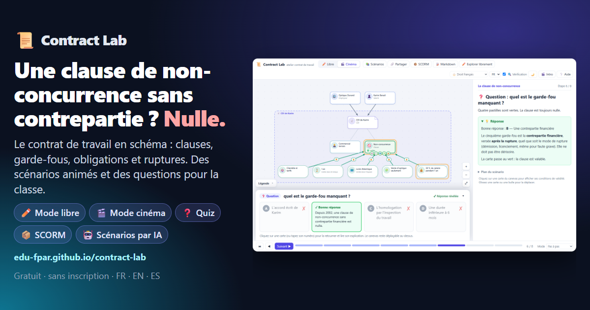
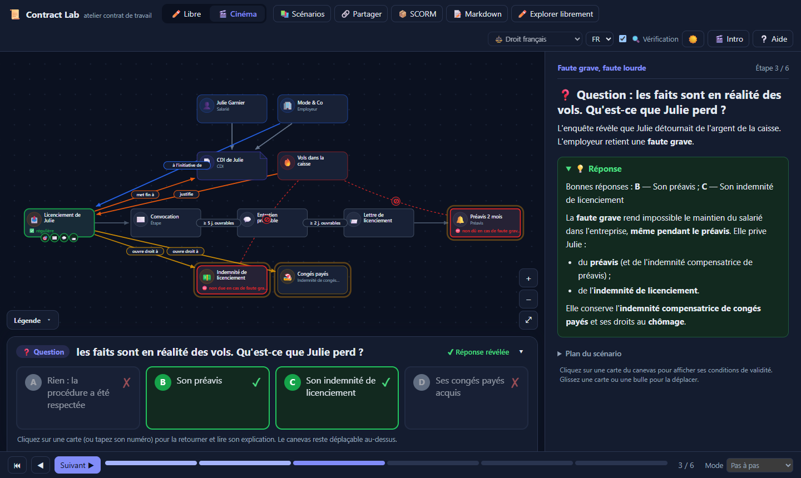
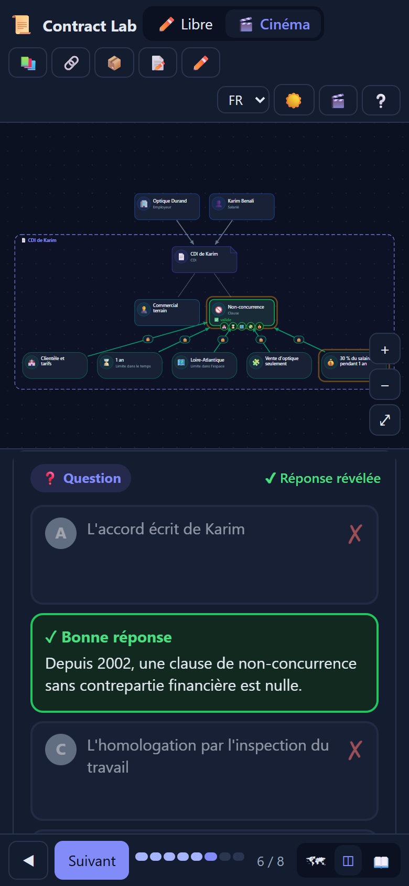

# Contract Lab — atelier contrat de travail

[](https://doi.org/10.5281/zenodo.24508195)
Code source : [github.com/edu-fpar/contract-lab](https://github.com/edu-fpar/contract-lab)

**Français** · 🇬🇧 [English](README.en.md) · 🇪🇸 [Español](README.es.md)

[](https://edu-fpar.github.io/contract-lab/?scenario=non-concurrence&etape=6)

Outil pédagogique pour visualiser et expliquer le **contrat de travail** et le **droit du travail** :
un contrat et ses **clauses** en icônes, les **garde-fous** qui les rendent valables, les **incompatibilités**,
les **obligations** des parties, les **ruptures** avec leur procédure et les **indemnités** qu'elles ouvrent.
L'outil vérifie chaque élément et affiche un verdict : ✅ valide, ⚠️ à risque, ⛔ nulle ou irrégulière, ⚡ obligation violée.

**▶ En ligne : [edu-fpar.github.io/contract-lab](https://edu-fpar.github.io/contract-lab/)** (aussi sur téléphone) ·
🎬 [visite guidée en vidéo](https://edu-fpar.github.io/contract-lab/intro.html) ·
📖 [documentation](https://edu-fpar.github.io/contract-lab/docs/)

**Trois langues, trois droits** : français (droit français), anglais (droit anglais, Angleterre et pays de Galles, ou droit français en anglais) et espagnol (droit espagnol, Estatuto de los Trabajadores). Langue : sélecteur de la barre d'outils, ou `?lang=en` / `?lang=es`. Droit : sélecteur de la barre d'outils, ou `droit: uk` / `droit: es` en tête d'un scénario. Les clauses, garde-fous, calculs et scénarios suivent le droit choisi.

Aucune installation : ouvrez `index.html` (double-clic) ou servez le dossier avec UwAmp
(`http://localhost/edu-fpar/contract-lab/`). Pas de dépendance externe, fonctionne hors ligne.

## Deux modes

- **✏️ Libre** : palette d'éléments classés par familles (parties, contrats, clauses, garde-fous, obligations,
  fautes, ruptures, procédure, indemnités, normes), avec recherche ; liens tirés depuis la poignée `+` ;
  vérification automatique (conditions de validité, incompatibilités, calculs de période d'essai, de CDD,
  de préavis et d'indemnités). Les **pastilles** sous une carte montrent ses garde-fous ; le bouton **＋** de
  l'inspecteur ajoute un garde-fou manquant. La case **🔍 Vérification** masque les verdicts pour laisser la classe juger.
  Le **📸 Studio** capture des étapes commentées et les exporte en scénario markdown ; **🔗 Partager** donne un lien qui contient le schéma.

  

- **🎬 Cinéma** : déroule un scénario markdown, en **pas à pas** ou en **lecture continue**
  (rythme réglable), avec des **questions à la salle** et une vue adaptée au téléphone.
  Lien direct : `?scenario=non-concurrence&etape=6`, `?scenarios`, ou le bouton 🔗 Partager.
  Le bouton **📦 SCORM** exporte le scénario en paquet pour Moodle ou un autre LMS (achèvement, reprise, note).

  

<p align="center"></p>

## Trois droits

| Droit | Contenu | Scénarios |
|---|---|---|
| 🇫🇷 **Droit français** | CDI, CDD, période d'essai, non-concurrence et sa contrepartie, mobilité, exclusivité, dédit-formation, temps de travail, licenciement pour motif personnel et économique, faute grave, rupture conventionnelle, démission, prise d'acte ; indemnités calculées | 13, en français (`js/library.js`) et en anglais (`js/library-en.js`) |
| 🇬🇧 **Droit anglais** | *written statement*, *restrictive covenants*, *garden leave*, PILON, *unfair dismissal* (Burchell, code ACAS, Polkey), *redundancy*, *settlement agreements* ; préavis légal, *redundancy pay*, *basic* et *compensatory award* | 9, en anglais (`js/library-uk.js`) |
| 🇪🇸 **Droit espagnol** | contrat indéfini et temporaires (réforme de 2021), période d'essai, pactes de non-concurrence, de permanence et d'exclusivité, temps de travail, SMI, licenciement disciplinaire, objectif, collectif, *improcedente* et nul, démission, art. 50 ET ; indemnités 20 / 33 / 12 jours par an et leurs plafonds | 11, en espagnol (`js/library-es.js`) |

Les montants annuels (SMI, plafonds anglais…) sont des paramètres avec une valeur par défaut, à mettre à jour ; les réformes annoncées sont signalées ⚠️.

## Partager

Chaque langue a sa page d'entrée, avec son propre aperçu sur les réseaux sociaux (titre, description, image) :

| | Lien | Aperçu |
|---|---|---|
| 🇫🇷 | https://edu-fpar.github.io/contract-lab/ | [visuels/fr/og.png](visuels/fr/og.png) |
| 🇬🇧 | https://edu-fpar.github.io/contract-lab/en/ | [visuels/en/og.png](visuels/en/og.png) |
| 🇪🇸 | https://edu-fpar.github.io/contract-lab/es/ | [visuels/es/og.png](visuels/es/og.png) |

Le bouton **🔗 Partager** de l'application construit ces liens (étape, scénario, bibliothèque, schéma du mode libre) dans la langue choisie.
Visuels prêts à poster (carré, portrait, story, captures) et textes de posts dans les trois langues : [visuels/](visuels/README.md).

## Écrire un scénario (enseignant ou IA)

Le format complet est dans l'application (❔ Aide → « Format des scénarios »), avec un bouton
**🤖 Copier le prompt pour une IA** qui contient la spécification prête à coller dans un assistant.

````markdown
# Mon scénario
> Description courte.

## 1. Première étape
Commentaire en **markdown**.

```scene
employeur EMP "Optique Durand"
salarie KAR "Karim" categorie=employe anciennete=3 salaire=2400
cdi CT "CDI de Karim"
EMP KAR -> CT
non_concurrence NC "Non-concurrence"
CT -> NC
focus NC
```
````

## Documentation et skill IA

- Documentation complète : [docs](https://edu-fpar.github.io/contract-lab/docs/) en français, [en anglais](https://edu-fpar.github.io/contract-lab/docs/#/en/), [en espagnol](https://edu-fpar.github.io/contract-lab/docs/#/es/) (Docsify, à ouvrir via un serveur web, comme UwAmp). Les pages sont aussi lisibles directement : `docs/*.md`, `docs/en/*.md`, `docs/es/*.md`.
- Skill Claude pour générer un scénario à partir d'un support de cours : `skill/scenario-contract-lab.skill` (voir `docs/ia-et-skill.md`) ; le script `verifier.js` rejoue le scénario avec le vrai moteur (`--lang en`, `--lang es`).
- Après une modification du moteur, du format ou des scénarios : `node tools/build.js`, puis `python tools/package_skill.py`.
- Chaînes d'interface non traduites : `node tools/i18n-check.js`.
- Captures de la documentation et visuels : `node tools/screenshots.js` (Edge ou Chrome sans fenêtre, aucune dépendance) ; voir [visuels/README.md](visuels/README.md).

## Fichiers

| Fichier | Rôle |
|---|---|
| `js/i18n.js`, `js/i18n-en.js`, `js/i18n-es.js` | langue de l'interface et dictionnaires anglais et espagnol |
| `js/model.js` | moteur : catalogue du droit français, relations, droits (`P.setJuris`), vérification (conditions de validité, incompatibilités, calculs), disposition auto |
| `js/catalog-fr-en.js` | traduction anglaise du catalogue français |
| `js/catalog-uk.js`, `js/catalog-es.js` | catalogues du droit anglais et du droit espagnol, et leurs calculs |
| `js/scenario.js` | parseur markdown → étapes, commandes (mots-clés français, anglais, espagnols), export studio, rendu markdown |
| `js/app.js` | interface : canevas SVG, palette, inspecteur, lecteur cinéma, studio, partage |
| `js/library.js`, `js/library-en.js`, `js/library-uk.js`, `js/library-es.js` | scénarios intégrés |
| `js/docs.js` | aide, spécification du format, prompt IA (trois langues) |
| `js/scorm.js`, `js/scorm-runtime.js` | export SCORM et dialogue avec la plateforme dans le paquet |
| `intro.html`, `intro/kit/`, `js/intro-launcher.js` | visite guidée en vidéo (anim-kit), en trois langues, et son ouverture dans l'application |
| `en/`, `es/` | pages d'entrée anglaise et espagnole (aperçus de partage) |
| `visuels/`, `tools/visuels.html` | visuels de communication par langue et leur gabarit |

## Remerciements

Contract Lab reprend le moteur de scénarios de **Capital Lab**, né de l'outil imaginé par **Tao** pour montrer à sa classe de droit financier comment on peut contrôler une société tout en y étant minoritaire, et transmis par **Yannick**. Merci à eux.

## Licence et citation

© 2026 François Parlant — [CC BY-NC-SA 4.0](https://creativecommons.org/licenses/by-nc-sa/4.0/deed.fr). L'usage en classe et en formation est libre, en citant l'auteur ; vos adaptations se partagent sous la même licence. Voir [LICENSE](LICENSE).

**Usage commercial** (organisme de formation, éditeur, marque blanche, scénarios sur mesure, paquets SCORM personnalisés) : une licence commerciale est possible sur accord. [Me contacter](https://edu-fpar.github.io/about.html).

**Citer cet outil** (bouton *Cite this repository* de GitHub, d'après [CITATION.cff](CITATION.cff)) :

> Parlant, F. (2026). *Contract Lab* [Logiciel pédagogique]. Zenodo. https://doi.org/10.5281/zenodo.24508195

Vous l'utilisez en cours ? [Dites-le-moi](https://www.linkedin.com/in/francois-parlant/) : ces retours m'aident à faire connaître et améliorer l'outil.
