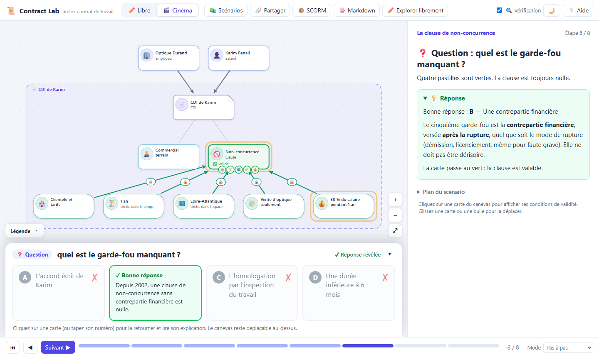
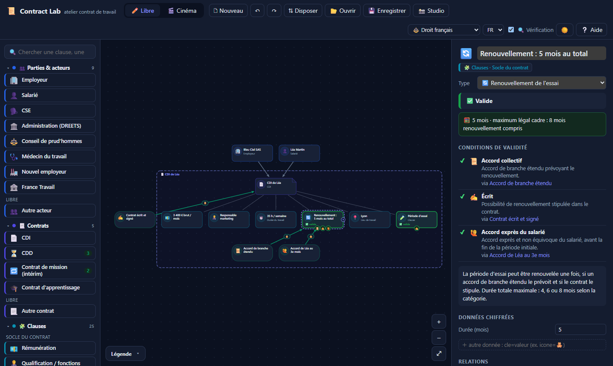
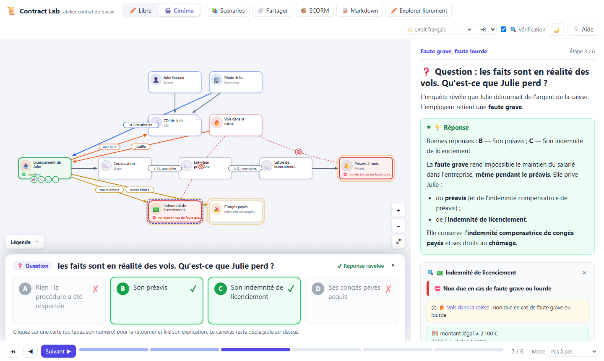
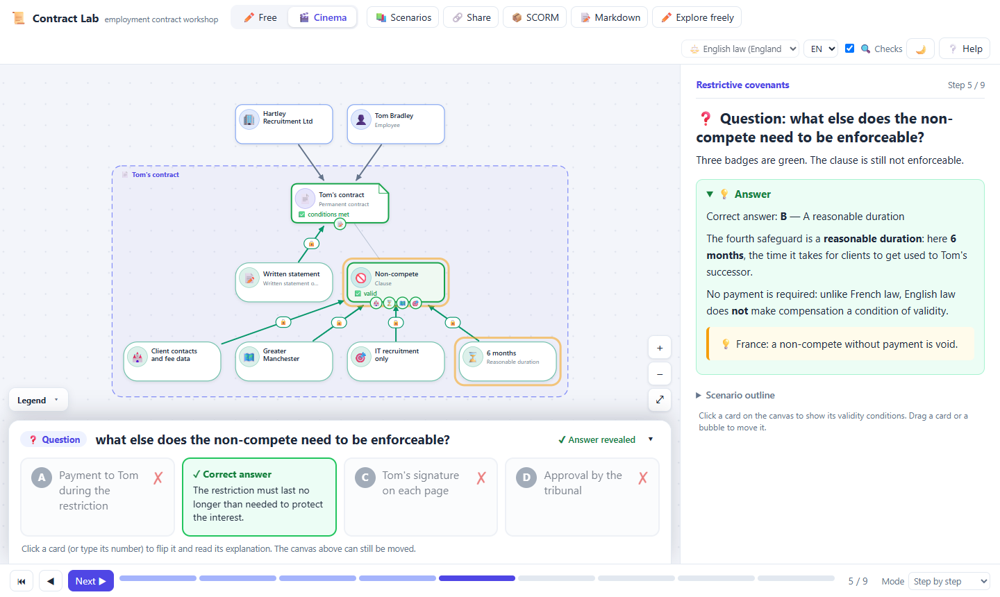
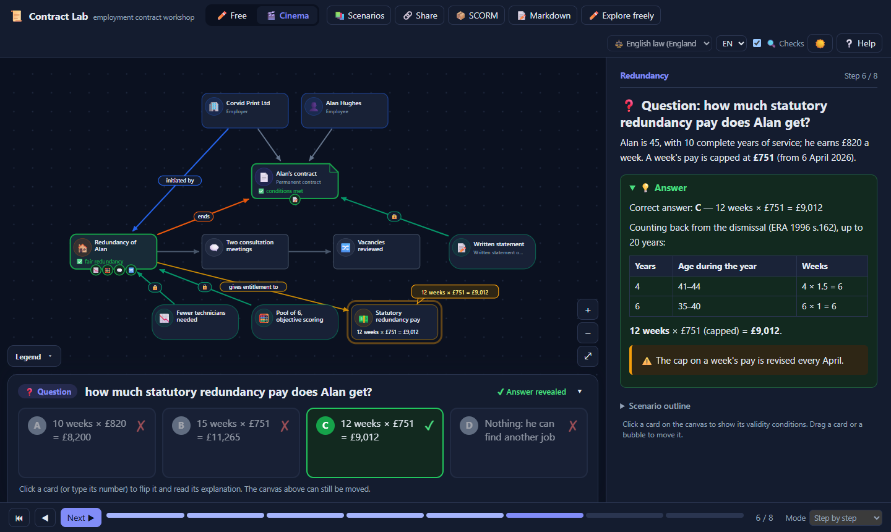

# Contract Lab — atelier contrat de travail

[](https://doi.org/10.5281/zenodo.24508195)

**▶ En ligne : [edu-fpar.github.io/contract-lab](https://edu-fpar.github.io/contract-lab/)** (aussi sur téléphone) · 🎬 [visite guidée en vidéo](https://edu-fpar.github.io/contract-lab/intro.html) · [documentation](https://edu-fpar.github.io/contract-lab/docs/) · 🇬🇧 [English below](#english) (English law and English interface)

[](https://edu-fpar.github.io/contract-lab/?scenario=non-concurrence&etape=6)

Outil pédagogique pour visualiser et expliquer le **contrat de travail** et le **droit du travail** :
un contrat et ses **clauses** en icônes, les **garde-fous** qui les rendent valables, les **incompatibilités**,
les **obligations** des parties, les **ruptures** avec leur procédure et les **indemnités** qu'elles ouvrent.
L'outil vérifie chaque élément et affiche un verdict : ✅ valide, ⚠️ à risque, ⛔ nulle ou irrégulière, ⚡ obligation violée.

Deux droits : le **droit français** et le **droit anglais** (Angleterre et pays de Galles : *written statement*, *restrictive covenants*, *unfair dismissal*, *redundancy*, *settlement agreements*…), choisi dans la barre d'outils ou par `droit: uk` en tête d'un scénario.
Deux langues d'interface : français et anglais (`?lang=en`).

Aucune installation : ouvrez `index.html` (double-clic) ou servez le dossier avec UwAmp
(`http://localhost/edu-fpar/contract-lab/`). Pas de dépendance externe, fonctionne hors ligne.

## Deux modes

- **✏️ Libre** : palette d'éléments classés par familles (parties, contrats, clauses, garde-fous, obligations,
  fautes, ruptures, procédure, indemnités, normes), avec recherche ; liens tirés depuis la poignée `+` ;
  vérification automatique (conditions de validité, incompatibilités, calculs de période d'essai, de CDD,
  de préavis et d'indemnités). Les **pastilles** sous une carte montrent ses garde-fous ; le bouton **＋** de
  l'inspecteur ajoute un garde-fou manquant. La case **🔍 Vérification** masque les verdicts pour laisser la classe juger.
  Le **📸 Studio** capture des étapes commentées et les exporte en scénario markdown.

  

- **🎬 Cinéma** : déroule un scénario markdown, en **pas à pas** ou en **lecture continue**
  (rythme réglable), avec des **questions à la salle** et une vue adaptée au téléphone.
  Lien direct : `?scenario=non-concurrence&etape=6`, `?scenarios`, ou le bouton 🔗 Partager.
  Le bouton **📦 SCORM** exporte le scénario en paquet pour Moodle ou un autre LMS (achèvement, reprise, note).

  

## Scénarios intégrés

`construire-contrat`, `non-concurrence`, `clauses-encadrees`, `cdd`, `temps-de-travail`, `obligations`,
`licenciement`, `faute-grave`, `rupture-conventionnelle`, `depart-salarie`, `periode-essai`,
`hierarchie-normes`, `quiz-ruptures` — dans `js/library.js`, et leur version anglaise dans `js/library-en.js`.
Droit anglais (en anglais) : `uk-contract`, `uk-covenants`, `uk-probation-notice`, `uk-misconduct`, `uk-gross-misconduct`,
`uk-redundancy`, `uk-settlement`, `uk-constructive`, `uk-quiz` — dans `js/library-uk.js`.

## Écrire un scénario (enseignant ou IA)

Le format complet est dans l'application (❔ Aide → « Format des scénarios »), avec un bouton
**🤖 Copier le prompt pour une IA** qui contient la spécification prête à coller dans un assistant.

````markdown
# Mon scénario
> Description courte.

## 1. Première étape
Commentaire en **markdown**.

```scene
employeur EMP "Optique Durand"
salarie KAR "Karim" categorie=employe anciennete=3 salaire=2400
cdi CT "CDI de Karim"
EMP KAR -> CT
non_concurrence NC "Non-concurrence"
CT -> NC
focus NC
```
````

## Documentation et skill IA

- Documentation complète : `docs/index.html` (en anglais : `docs/index.html#/en/`) (Docsify, à ouvrir via un serveur web, comme UwAmp). Les pages sont aussi lisibles directement : ce sont les fichiers `docs/*.md`.
- Skill Claude pour générer un scénario à partir d'un support de cours : `skill/scenario-contract-lab.skill` (voir `docs/ia-et-skill.md`).
- Après une modification du moteur, du format ou des scénarios : `node tools/build.js`, puis `python tools/package_skill.py`.
- Captures d'écran (README et documentation) : `node tools/screenshots.js` (Edge ou Chrome sans fenêtre, aucune dépendance).

## Fichiers

| Fichier | Rôle |
|---|---|
| `js/i18n.js`, `js/i18n-en.js` | langue de l'interface et dictionnaire anglais |
| `js/model.js` | moteur : catalogue du droit français, relations, droits (`P.setJuris`), vérification (conditions de validité, incompatibilités, calculs), disposition auto |
| `js/catalog-fr-en.js` | traduction anglaise du catalogue français |
| `js/catalog-uk.js` | catalogue du droit anglais (England & Wales) et ses calculs |
| `js/scenario.js` | parseur markdown → étapes, commandes, export studio, rendu markdown |
| `js/app.js` | interface : canevas SVG, palette, inspecteur, lecteur cinéma, studio |
| `js/library.js`, `js/library-en.js`, `js/library-uk.js` | scénarios intégrés (français, anglais, droit anglais) |
| `js/docs.js` | aide, spécification du format, prompt IA |
| `js/scorm.js`, `js/scorm-runtime.js` | export SCORM et dialogue avec la plateforme dans le paquet |
| `intro.html`, `intro/kit/`, `js/intro-launcher.js` | visite guidée en vidéo (anim-kit) et son ouverture dans l'application (bouton 🎬 Intro, première visite) |

## Remerciements

Contract Lab reprend le moteur de scénarios de **Capital Lab**, né de l'outil imaginé par **Tao** pour montrer à sa classe de droit financier comment on peut contrôler une société tout en y étant minoritaire, et transmis par **Yannick**. Merci à eux.

---

## Licence et citation

© 2026 François Parlant — [CC BY-NC-SA 4.0](https://creativecommons.org/licenses/by-nc-sa/4.0/deed.fr). L'usage en classe et en formation est libre, en citant l'auteur ; vos adaptations se partagent sous la même licence. Voir [LICENSE](LICENSE).

**Usage commercial** (organisme de formation, éditeur, marque blanche, scénarios sur mesure, paquets SCORM personnalisés) : une licence commerciale est possible sur accord. [Me contacter](https://edu-fpar.github.io/about.html).

**Citer cet outil** (bouton *Cite this repository* de GitHub, d'après [CITATION.cff](CITATION.cff)) :

> Parlant, F. (2026). *Contract Lab* [Logiciel pédagogique]. Zenodo. https://doi.org/10.5281/zenodo.24508195

Vous l'utilisez en cours ? [Dites-le-moi](https://www.linkedin.com/in/francois-parlant/) : ces retours m'aident à faire connaître et améliorer l'outil.

<a id="english"></a>

## 🇬🇧 English

**Contract Lab** is a browser-only teaching tool to visualise and explain the **contract of employment** and **employment law**:
a contract and its **clauses** as icons, the **safeguards** that make them valid or enforceable, the **incompatibilities**,
the parties' **obligations**, **terminations** with their procedure and the **payments** they open.
The tool checks each item and shows a verdict: ✅ valid, ⚠️ at risk, ⛔ void, unfair or unenforceable, ⚡ obligation breached.

**▶ Online: [edu-fpar.github.io/contract-lab/?lang=en](https://edu-fpar.github.io/contract-lab/?lang=en)** (also on a phone) ·
🎬 [guided video tour](https://edu-fpar.github.io/contract-lab/intro.html?lang=en) ·
[documentation in English](https://edu-fpar.github.io/contract-lab/docs/#/en/)

No installation: open `index.html` (double-click) or serve the folder with any web server, then add `?lang=en`. No external dependency, works offline.

[](https://edu-fpar.github.io/contract-lab/?lang=en&scenario=uk-covenants&etape=5)



### Two laws

- **English law (England & Wales)** — employee and worker status, written statement of particulars, key terms, 48-hour opt-out, deductions from wages,
  restrictive covenants (legitimate interest and reasonableness, no payment needed), garden leave and PILON, unfair dismissal (misconduct, capability, redundancy:
  Burchell, ACAS Code, band of reasonable responses, Polkey), summary, wrongful and constructive dismissal, settlement agreements (ERA 1996 s.203).
  Calculations: qualifying period, statutory notice (s.86), notice pay, statutory redundancy pay and basic award (age bands, week's pay cap), compensatory award
  (Polkey, ACAS uplift, cap), minimum wage. Figures from 6 April 2026 as parameters; Employment Rights Act 2025 reforms flagged. Choose it with `droit: uk`
  at the top of a scenario, or with the law selector.
- **French law** — CDI, CDD, probation, non-compete with financial compensation, mobility, exclusivity, dismissal for personal reasons, gross misconduct,
  mutual termination (rupture conventionnelle), resignation, prise d'acte; with English labels when the interface is in English.

### Two modes

- **✏️ Free**: palette of items by family, links drawn from the `+` handle, automatic checks, badges for the safeguards, **＋** to add a missing one,
  **🔍 Checks** box to hide the verdicts and let the class decide, **📸 Studio** to capture commented steps and export a markdown scenario.
- **🎬 Cinema**: plays a markdown scenario step by step or continuously, with **questions for the class**, a phone layout,
  share links (`?lang=en&scenario=uk-covenants&etape=5`) and a **📦 SCORM** export for Moodle or another LMS.

### Scenarios

English law: `uk-contract`, `uk-covenants`, `uk-probation-notice`, `uk-misconduct`, `uk-gross-misconduct`, `uk-redundancy`, `uk-settlement`,
`uk-constructive`, `uk-quiz` (`js/library-uk.js`). French law in English: the thirteen French scenarios, same ids (`js/library-en.js`).
See [docs/en/scenarios.md](docs/en/scenarios.md).

### Writing a scenario with an AI

Give any AI the instructions page [docs/en/instructions-ia.md](https://edu-fpar.github.io/contract-lab/docs/en/instructions-ia.md) with your course,
or use the bilingual Claude skill `skill/scenario-contract-lab.skill`, which replays the scenario with the real engine
(`node skill/scenario-contract-lab/scripts/verifier.js scenario.md --lang en`). Format: [docs/en/format-scenario.md](docs/en/format-scenario.md).
After changing the engine, the catalogues or the scenarios: `node tools/build.js`, then `python tools/package_skill.py`.

### Credits

Contract Lab reuses the scenario engine of **Capital Lab**, which grew out of the tool devised by **Tao** to show his financial law class how a company
can be controlled by a minority shareholder, and passed on by **Yannick**. Many thanks to them.

### License and citation

© 2026 François Parlant — [CC BY-NC-SA 4.0](https://creativecommons.org/licenses/by-nc-sa/4.0/). Using it in class or in training is free, with credit to the author; adaptations must be shared under the same license. See [LICENSE](LICENSE).

**Commercial use** (training company, publisher, white label, custom scenarios, tailored SCORM packages): a commercial license is available by agreement. [Get in touch](https://edu-fpar.github.io/about.html?lang=en).

**How to cite** (GitHub's *Cite this repository* button, from [CITATION.cff](CITATION.cff)):

> Parlant, F. (2026). *Contract Lab* [Educational software]. Zenodo. https://doi.org/10.5281/zenodo.24508195

Using it in class? [Let me know](https://www.linkedin.com/in/francois-parlant/): this feedback helps me improve the tool and spread the word.
