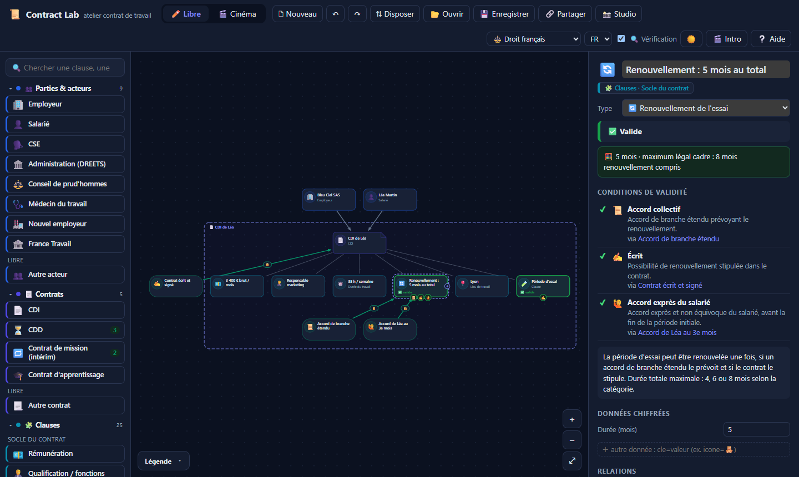
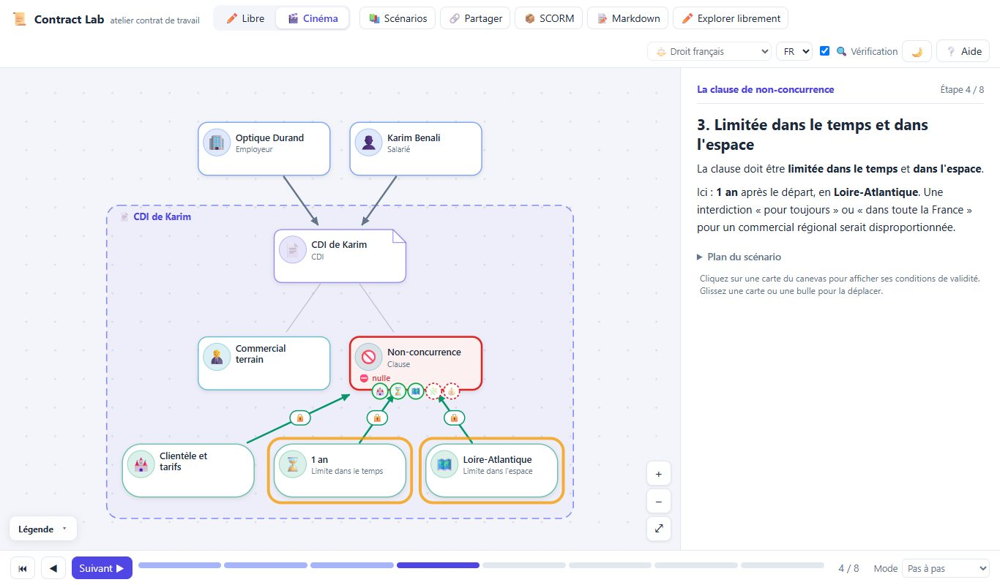

[🇬🇧 English version](en/README.md) · [🇪🇸 Versión en español (derecho español)](es/README.md)

# Contract Lab — atelier contrat de travail

**Contract Lab** est un outil pédagogique pour visualiser le **contrat de travail** et comprendre **ce qui rend une clause valable, une rupture régulière, et quels droits elle ouvre**.

Chaque élément du droit du travail devient une carte : le contrat et ses clauses, les **garde-fous** qui les conditionnent, les **obligations** des parties et les **manquements**, les **ruptures** et leur procédure, les **indemnités**. L'outil vérifie l'ensemble et affiche un verdict : ✅ valide, ⚠️ à risque, ⛔ nulle ou irrégulière, ⚡ obligation violée. Une clause de non-concurrence sans contrepartie financière passe au rouge ; une faute grave fait disparaître le préavis et l'indemnité de licenciement.

[▶ Ouvrir l'atelier](../index.html ':ignore') — en ligne : **https://edu-fpar.github.io/contract-lab/**, utilisable aussi sur téléphone.

L'atelier existe aussi **en anglais** (`?lang=en`) et connaît deux droits : le **droit français** et le **droit anglais** (Angleterre et pays de Galles : *restrictive covenants*, *unfair dismissal*, *redundancy*, *settlement agreements*…), choisi par la ligne `droit: uk` en tête d'un scénario. Voir la [documentation en anglais](en/README.md).

Le mode libre (nuit) : le contrat de Léa et ses clauses dans leur cadre ; à droite, les conditions de validité du renouvellement de l'essai, toutes remplies.

## 🤖 Préparer son cours avec une IA

<ol class="ai-steps">
<li><strong>Copiez la consigne.</strong> Elle contient déjà le lien vers les instructions pour l'IA. Le texte est modifiable : adaptez le public ou le nombre d'étapes avant de copier.

Lis les instructions sur https://edu-fpar.github.io/contract-lab/docs/instructions-ia.md et prépare un scénario Contract Lab à partir du cours ci-dessous (ou du fichier joint). Public : BTS / licence RH, 6 à 8 étapes, avec deux questions pour la salle.

<button class="ai-btn big" data-copy-sel=".js-ia-prompt">📋 Copier la consigne</button></li>
<li><strong>Collez-la dans votre IA</strong> (ChatGPT, Claude, Gemini, Mistral, Copilot…), puis ajoutez votre cours : texte collé à la suite, ou fichier joint.</li>
<li><strong>Copiez la réponse de l'IA</strong> et collez-la dans l'<a href="../index.html?scenarios" target="_blank" rel="noopener">atelier</a> : 🎬 Cinéma → 📚 Scénarios → Lancer. Vous pouvez coller la réponse entière.</li>
</ol>

Votre IA ne peut pas ouvrir de lien ?

Copiez à la place la version complète : les instructions et la consigne réunies en un seul texte. Collez-le dans votre IA, puis ajoutez votre cours.

<button class="ai-btn warn" data-copy-full="instructions-ia.md">📄 Copier la version complète</button> <a class="ai-link" href="instructions-ia.md" target="_blank" rel="noopener">voir les instructions</a>

💡 Vous utilisez Claude ? La <a href="#/ia-et-skill">skill Contract Lab</a> vérifie en plus chaque verdict avec le moteur de l'atelier.

ℹ️ Vous consultez cette documentation en local : la consigne pointe vers la version publiée, qu'une IA en ligne peut lire.

## Deux façons d'utiliser l'atelier

| | Mode libre ✏️ | Mode cinéma 🎬 |
|---|---|---|
| Pour qui | l'enseignant qui prépare, l'étudiant qui expérimente | la classe, pendant le cours ; l'étudiant qui révise sur téléphone |
| Principe | on construit un contrat ou un dossier de rupture à la souris, on ajoute les garde-fous et on lit les verdicts | un scénario markdown déroule la construction étape par étape, avec un commentaire et des questions à la salle |
| Rythme | libre | pas à pas, ou lecture continue à vitesse réglable |

Les deux modes partagent le même moteur de vérification : conditions de validité, incompatibilités, obligations violées, calculs (période d'essai, durée du CDD, préavis, indemnité légale, rupture conventionnelle, prime de précarité).

Le mode cinéma (jour) : la clause de non-concurrence se construit garde-fou par garde-fou ; le commentaire est à droite.

## Par où commencer ?

- **Découvrir** : ouvrez l'atelier, passez en mode 🎬 Cinéma et lancez « La clause de non-concurrence ».
- **Présenter en classe** : [Mode cinéma](mode-cinema.md), [scénarios disponibles](scenarios.md) et [liens de partage](mode-cinema.md#partager-un-lien).
- **Construire son propre contrat ou dossier** : [Prise en main du mode libre](prise-en-main.md).
- **Écrire un scénario** : avec une IA (ci-dessus, ou la [skill](ia-et-skill.md)), ou à la main avec le [format des scénarios](format-scenario.md).
- **Comprendre un verdict surprenant** : [Règles de vérification](regles-de-calcul.md).

## Installation

Aucune. L'atelier est un ensemble de fichiers HTML, CSS et JavaScript sans dépendance :
- en ligne sur **https://edu-fpar.github.io/contract-lab/** ;
- servi par un serveur web local (UwAmp, par exemple : `http://localhost/edu-fpar/contract-lab/`) ;
- ou ouvert directement en double-cliquant sur `index.html`.

Le bouton 🌙 / ☀️ en haut à droite bascule entre mode jour et mode nuit, ici comme dans l'atelier.

Cette documentation a besoin d'un serveur web et d'une connexion internet (elle utilise [Docsify](https://docsify.js.org)). Sans cela, ses pages restent lisibles telles quelles : ce sont les fichiers `.md` du dossier `docs/`.

## Remerciements

Contract Lab reprend le moteur de scénarios de **Capital Lab**, né de l'outil imaginé par **Tao** pour montrer à sa classe de droit financier comment on peut contrôler une société tout en y étant minoritaire, et transmis par **Yannick**. Merci à eux.
