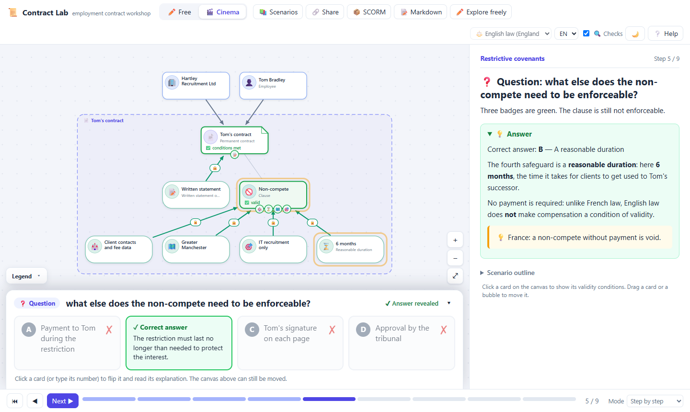
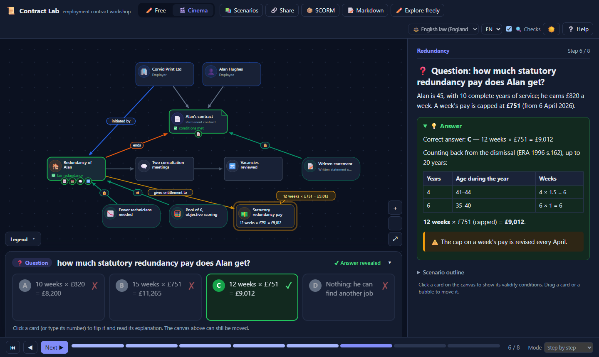
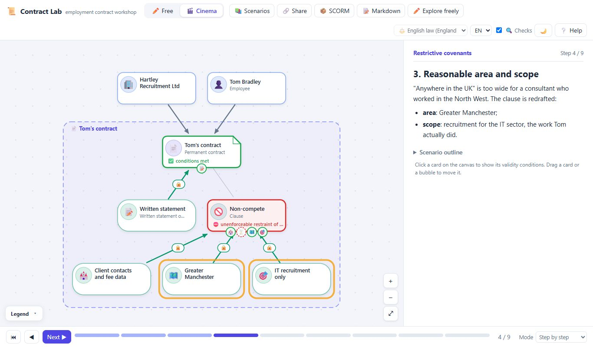

[🇫🇷 Version française](../README.md)

# Contract Lab — employment contract workshop

**Contract Lab** is a teaching tool to visualise the **contract of employment** and understand **what makes a clause enforceable, a dismissal fair, and which payments it opens** — under **English law (England & Wales)** or **French law**.

Each element of employment law becomes a card: the contract and its clauses, the **safeguards** that condition them, the parties' **obligations** and **breaches**, **terminations** and their procedure, **payments**. The tool checks the whole and shows a verdict: ✅ valid, ⚠️ at risk, ⛔ void, unfair or unenforceable, ⚡ obligation breached. A non-compete without a legitimate interest and a reasonable duration turns red; gross misconduct removes the notice and the notice pay; a redundancy shows its statutory redundancy pay, week's pay cap included.

[▶ Open the workshop](../index.html?lang=en ':ignore') — online: **https://edu-fpar.github.io/contract-lab/?lang=en**, also usable on a phone.

Cinema mode, English law: the non-compete turns green when its last safeguard (a reasonable duration) is added; the classroom question has just been revealed.

Redundancy (night theme): the procedure chain and statutory redundancy pay, 12 weeks × £751 = £9,012.

## 🤖 Prepare your course with an AI

<ol class="ai-steps">
<li><strong>Copy the instruction.</strong> It already contains the link to the instructions for the AI. The text is editable: adapt the audience, the law or the number of steps before copying.

Read the instructions at https://edu-fpar.github.io/contract-lab/docs/en/instructions-ia.md and prepare a Contract Lab scenario from the course below (or the attached file). Audience: HR / employment law students (undergraduate), 6 to 8 steps, with two questions for the class.

<button class="ai-btn big" data-copy-sel=".js-ia-prompt">📋 Copy the instruction</button></li>
<li><strong>Paste it into your AI</strong> (ChatGPT, Claude, Gemini, Mistral, Copilot…), then add your course: text pasted after it, or an attached file. The AI chooses English law (<code>droit: uk</code>) or French law from your course.</li>
<li><strong>Copy the AI's answer</strong> and paste it into the <a href="../index.html?lang=en&scenarios" target="_blank" rel="noopener">workshop</a>: 🎬 Cinema → 📚 Scenarios → Start. You can paste the whole answer.</li>
</ol>

Your AI cannot open links?

Copy the full version instead: the instructions and the request in a single text. Paste it into your AI, then add your course.

<button class="ai-btn warn" data-copy-full="en/instructions-ia.md">📄 Copy the full version</button> <a class="ai-link" href="en/instructions-ia.md" target="_blank" rel="noopener">see the instructions</a>

💡 Using Claude? The <a href="#/en/ai-and-skill">Contract Lab skill</a> also checks every verdict with the workshop's engine.

ℹ️ You are reading this documentation locally: the instruction points to the published version, which an online AI can read.

## Two laws

| | 🇬🇧 English law (England & Wales) | 🇫🇷 French law |
|---|---|---|
| Choose it | front matter `droit: uk` at the top of the scenario, or the law selector of the free mode | the default |
| Covers | employee / worker status, written statement, key terms, 48-hour opt-out, deductions, restrictive covenants, garden leave, PILON, unfair dismissal (misconduct, capability, redundancy), summary and wrongful dismissal, constructive dismissal, settlement agreements, ACAS Code | CDI, CDD, probation, non-compete with compensation, mobility, exclusivity, dismissal for personal reasons, gross misconduct, mutual termination (rupture conventionnelle), resignation, prise d'acte, sources of French law |
| Calculations | qualifying period, statutory notice, notice pay, statutory redundancy pay, basic and compensatory awards, minimum wage (figures from 6 April 2026, as parameters) | probation maximum, CDD duration, statutory notice and severance, mutual termination minimum, end-of-CDD payment |

The English catalogue states the law in force on 20 November 2026 and flags the **Employment Rights Act 2025** reforms (6-month qualifying period, no compensatory award cap, announced for 1 January 2027). See [Checking rules](checking-rules.md).

## Two ways to use the workshop

| | Free mode ✏️ | Cinema mode 🎬 |
|---|---|---|
| For whom | the teacher preparing, the student experimenting | the class, during the lesson; the student revising on a phone |
| Principle | build a contract or a termination file with the mouse, add the safeguards and read the verdicts | a markdown scenario plays the construction step by step, with a commentary and questions for the class |
| Pace | free | step by step, or continuous play at an adjustable speed |

Both modes share the same checking engine: validity conditions, incompatibilities, breached obligations, calculations.

Cinema mode (day theme), English law: the non-compete is built safeguard by safeguard; the missing one (a reasonable duration) shows as a dotted badge, and the commentary is on the right.

## Getting started

- **Discover**: open the [workshop in English](../index.html?lang=en&scenario=uk-covenants ':ignore'), cinema mode, scenario "Restrictive covenants".
- **Teach in class**: [Cinema mode](cinema-mode.md), [available scenarios](scenarios.md) and [share links](cinema-mode.md#sharing-a-link).
- **Build your own contract or file**: [Free mode](getting-started.md).
- **Write a scenario**: with an AI (above, or the [skill](ai-and-skill.md)), or by hand with the [scenario format](format-scenario.md).
- **Understand a surprising verdict**: [Checking rules](checking-rules.md).

## Installation

None. The workshop is a set of HTML, CSS and JavaScript files with no dependency:
- online at **https://edu-fpar.github.io/contract-lab/?lang=en**;
- served by a local web server (e.g. `python -m http.server`, or UwAmp: `http://localhost/edu-fpar/contract-lab/?lang=en`);
- or opened directly by double-clicking `index.html`.

The interface language is chosen with `?lang=en` (or `?lang=fr`), then remembered; the selector in the toolbar switches it too. The 🌙 / ☀️ button switches between day and night themes, here as in the workshop.

This documentation needs a web server and an internet connection (it uses [Docsify](https://docsify.js.org)). Without them, its pages remain readable as they are: they are the `.md` files of the `docs/en/` folder.

## Credits

Contract Lab reuses the scenario engine of **Capital Lab**, which grew out of the tool devised by **Tao** to show his financial law class how a company can be controlled by a minority shareholder, and passed on by **Yannick**. Many thanks to them.
