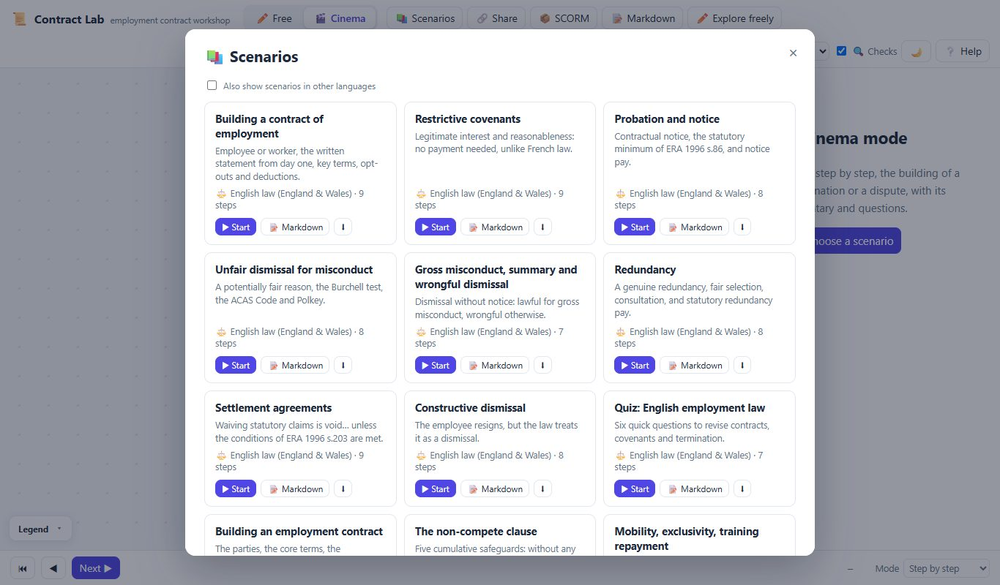
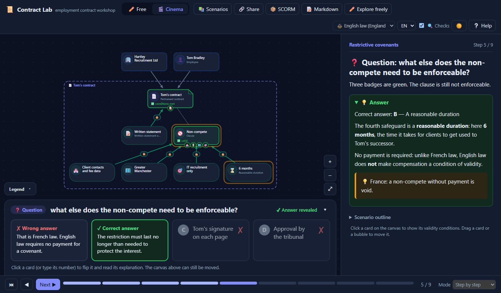

# Cinema mode

Cinema mode 🎬 plays a **scenario**: at each step the canvas comes alive (cards appearing, links being drawn, badges turning green, bubbles and highlights) and the right-hand panel shows the commentary.

## Loading a scenario

**📚 Scenarios** button:
- choose a scenario from the library ([list](scenarios.md)); in English, the library shows the English scenarios (English law and French law in English);
- or **paste** the markdown supplied by a colleague or an AI, then "▶ Start";
- or **open a file** `.md`. It can also be dropped directly onto the window.

The library in English: English-law scenarios first, then French law in English; below, the area where a scenario written by a colleague or an AI can be pasted.

## Sharing a link

The workshop is online at **https://edu-fpar.github.io/contract-lab/?lang=en**. The **🔗 Share** button offers three links to copy: to **the step displayed**, to **the start of the scenario**, or to **the library**. During playback the browser address follows the current step, so it can be copied directly too.

| Link | Opens |
|---|---|
| `…/contract-lab/?lang=en&scenarios` | the scenario library, in English |
| `…/contract-lab/?lang=en&scenario=uk-covenants` | a built-in scenario, at its first step |
| `…/contract-lab/?lang=en&scenario=uk-covenants&etape=5` | that scenario, directly at step 5 (the question) |
| `…/contract-lab/?md=address-of-the-file.md` | a scenario published as a file |
| `…/contract-lab/#md=…` | a personal scenario (pasted or generated by an AI), whose text is encoded in the link |

For a personal scenario, the link contains the compressed text of the scenario after the `#`: it is sent to no server and works without publishing anything. For a very long scenario the link may become too long for some messaging apps: publish the `.md` file instead and use `?md=`. In all cases, `&etape=N` chooses the arrival step (the introduction, if the scenario has one, counts as step 1). `lang=en` chooses the interface language; French scenarios and their English versions share the same identifier (`?lang=en&scenario=non-concurrence` opens the English version).

## Exporting to SCORM (Moodle)

The **📦 SCORM** button produces a `.zip` package to upload to Moodle ("SCORM package" activity) or any SCORM-compatible platform. The package contains the workshop and the scenario displayed, including a personal or modified one: students follow it on their own, step by step, without connecting to the site.

- **Version**: SCORM 1.2 (recommended for Moodle) or SCORM 2004 4th edition.
- **Completion**: the activity is "completed" when the student reaches the last step.
- **Resume**: coming back, the student resumes at the step where they stopped.
- **Score** (optional, if the scenario has multiple-choice questions): out of 100, the share of questions where the student clicked a right card *before* revealing the answer. Only the first attempt counts.

In the package only the player remains visible: no free mode, library or sharing.

## On a phone

The workshop adapts to narrow screens. On a phone, it opens directly on the scenario library:

 

- the **diagram** takes the top of the screen, the **explanations** the bottom;
- the **🗺 / ◫ / 📖** buttons of the bottom bar show the diagram only, both, or the text only;
- **swipe** the explanations left or right to change step; the **◀ / Next** buttons remain available;
- **pinch** the diagram to zoom, drag it to move, and tap a card to show its verdict and validity conditions under the text;
- **questions** are shown in the text, with stacked choices: tap a choice to give your answer, "Reveal the answer", then tap a card to flip it.

Free mode remains available, but it is designed for a wider screen.

## Step by step or continuous play

At the bottom of the screen:

| Control | Effect |
|---|---|
| ⏮ ◀ | back to the start, or to the previous step |
| Next ▶ | next step |
| progress bars | click a bar to go to that step |
| **Step by step** mode | the user moves forward |
| **Continuous play** mode | steps follow one another; ▶ / ⏸ to play or pause |
| Pace | from 0.25× to 3× |

In continuous play, the duration of a step depends on the length of its commentary (between 5 and 45 seconds at 1×), unless the scenario sets it with `duration`. A thin orange bar shows the time left.

Keyboard: **→** / **←** to move forward or back, **Space** to move forward (step by step) or play/pause (continuous), **Home** / **End** for the first and last steps, **F** to refit.

## Question steps

Some steps question the audience. Their title is preceded by ❓, and a window rises at the bottom of the canvas with the question and the choices as large cards (A, B, C…).

After the reveal: the right card in green, a wrong card flipped to read its explanation, and the non-compete turned green on the canvas.

1. **Let the class answer**: show of hands, orally… Click the card chosen by the majority, or type its number: it is marked "👥 class's choice".
2. **Reveal the answer**: "💡 Reveal the answer" button, **→** key, or the "💡 Answer ▶" button of the bottom bar. A presentation remote therefore works: a first press reveals, the next one moves to the following step.
3. **Comment on each choice**: right answers turn green, the others fade. Click a card, or type its number, to **flip** it and read why the choice is right or wrong.
4. **The general explanation** opens in the right-hand panel. The answer can also change the canvas: verdicts restored, safeguard added, highlight, bubble.

The window does not hide the diagram: the canvas refits above it, can still be moved and zoomed, and the **▾** button shrinks the window to a bar. In continuous play, playback stops on a question until the reveal, then resumes.

A question is usually preceded by `verification off`: verdicts and badges are hidden so that the canvas does not give the answer away; the answer restores them with `verification on`. To write a question, see the [scenario format](format-scenario.md#quiz-steps).

## Interacting during the presentation

- **Clicking a card** shows its full check under the commentary: verdict, calculations, validity conditions, usual consequences.
- **Hovering over a name** highlighted in the commentary highlights the matching card; clicking it selects it.
- **Moving a card or a bubble**: drag it. Useful when bubbles overlap or hide a link. Moves are kept from one step to the next; the **↺ Layout** button puts everything back where the scenario planned. These moves do not change the scenario itself.
- The "Scenario outline" panel jumps to any step.

## Editing or reusing

- **📝 Markdown** opens the text of the scenario: correct it and apply it while staying on the same step, copy it or download it.
- **✏️ Explore freely** copies the displayed state into free mode, to manipulate it (remove a safeguard, add gross misconduct, change the service…).

If a scenario contains commands that are not understood, a warning appears under the commentary, with the line number.
