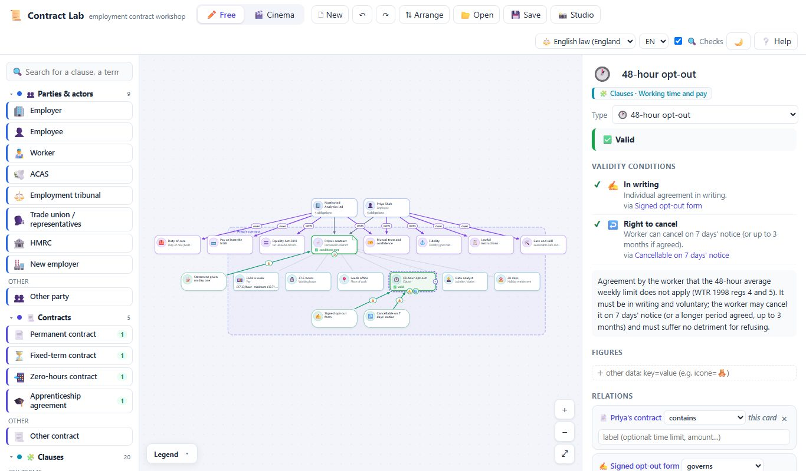

# Getting started (free mode)

Free mode ✏️ is for building a contract or a termination file, adding or removing safeguards and watching the effect on the verdicts. Open it in English with [`index.html?lang=en`](../index.html?lang=en ':ignore').

## The screen

- **on the left**, the palette: the elements of employment law, grouped by family, with a search field;
- **in the centre**, the canvas;
- **on the right**, the inspector: properties and checks of the selected item, or an overview if nothing is selected.

The palette on the left, the contract in the centre, the inspector on the right (English law): verdict, validity conditions and description of the 48-hour opt-out.

The **law selector** in the toolbar chooses the catalogue: English law (England & Wales) or French law. The language selector switches the interface between English and French. The 🌙 / ☀️ button switches between **day** and **night** themes; by default the workshop follows the system setting, and the choice is remembered in the browser.

## The palette

Items are grouped into ten families, each with its colour. Examples under English law:

| Family | Examples |
|---|---|
| 👥 Parties & actors | employer, employee, worker, ACAS, employment tribunal, trade union, HMRC, new employer |
| 📃 Contracts | permanent, fixed-term, zero-hours, apprenticeship |
| 🧩 Clauses | key terms (pay, hours, place, holiday, probation, notice, PILON), covenants and confidentiality (non-compete, non-solicitation, non-dealing, non-poaching, garden leave), working time and pay (48-hour opt-out, deductions), unenforceable terms |
| 🔒 Safeguards & conditions | legitimate business interest, reasonable duration / area / scope, written statement, in writing, independent advice, potentially fair reason, Burchell test, band of reasonable responses, genuine redundancy, fair selection… |
| 📌 Obligations | pay at least the minimum wage, duty of care, mutual trust and confidence, fidelity, obedience… |
| ⚡ Misconduct & breaches | breach, misconduct, gross misconduct, capability, harassment |
| 💔 Termination of the contract | resignation, dismissal for misconduct or capability, redundancy, summary, wrongful and constructive dismissal, settlement agreement, expiry of a fixed term, termination in probation |
| 🔹 Procedure | investigation, suspension, written notification, disciplinary meeting, right to be accompanied, warning, decision, appeal, consultation, notice period, protected conversation, ACAS early conciliation |
| 🎁 Payments & entitlements | unfair dismissal claim, notice pay, statutory redundancy pay, basic and compensatory awards, ACAS uplift, holiday pay, settlement payment |
| 📚 Legal sources | ERA 1996, Equality Act 2010, Working Time Regulations, ACAS Code, TULRCA, NMWA, common law, Employment Rights Act 2025 |

Under French law, the same families hold the French catalogue (CDI, CDD, non-compete with compensation, mobility, rupture conventionnelle…), with English labels when the interface is in English.

The small number on the right of an item is its number of **validity conditions**; a **!** flags a clause unlawful by nature. Hover over an item to read its description. The **🔍 Search** field filters the palette ("notice", "redundancy", "covenant"…). Each family also has a **free** item ("Other clause", "Other condition"…) for a notion missing from the catalogue.

## Building a contract

1. **Add an item**: drag it from the palette onto the canvas, or click it to add it in the middle of the view. Rename it in the inspector ("Tom's contract", "Non-compete 6 months"…).
2. **Link two items**: hover over a card, then drag the **+** handle on its right onto the other card. The relation is chosen from the types: an employee **signs** a contract, a contract **includes** a clause, a safeguard **limits** a clause, a misconduct **justifies** a termination, a termination **entitles** to a payment, two procedural steps follow each other with **then**. You can change it in the inspector, and add a label ("7 days", "£751 cap"…).
3. **Add and link in one go**: with a card selected, a click in the palette adds the item **next to it and links it**. A procedural step is added at the end of the existing chain.
4. **Enter the figures**: on the employee, `service` (years), `weekly_pay` and `age` (English law) — or `categorie`, `anciennete` and `salaire` (French law); on a probation or a covenant, the `duration` in months; on a notice clause, `notice_weeks`. The calculations find them in the case file.

Clauses linked to a contract (and their safeguards) are surrounded by a **📄 frame** bearing the contract's name: you see at a glance what the contract contains. In the inspector, the "＋ Link to…" list also creates a relation without using the canvas.

## Reading verdicts and badges

| Verdict | Meaning |
|---|---|
| ✅ valid (or "lawful", "fair", "conditions met") | all validity conditions are met |
| ⚠️ at risk | a less serious condition is missing (procedural flaw, no written statement, appeal missing…) |
| ⛔ void / unfair / unenforceable | an essential condition is missing, the clause is unlawful, or an incompatible item is in the case file |
| ⚡ breached | an obligation linked to a breach |

Under the card, the **badges** are its safeguards: **green** if present, **dotted** (red or amber) if missing. Hover over a badge to read the condition.

When you select the card, the inspector details:
- the **verdict**, with the precise effect ("unenforceable restraint of trade", "not due: gross misconduct"…) and the **incompatibilities** (⊘) found in the case file;
- the **calculations** (🧮): qualifying period, statutory notice, notice pay, redundancy pay with its age bands, compensatory award and its cap, minimum wage;
- the **Validity conditions** checklist: each condition, its justification, and what happens if it is missing ("Otherwise: …");
- the legal description of the item, its planned **incompatibilities** and **usual consequences** (for a termination: notice, payments, holiday pay…).

## ＋ Adding a missing safeguard

In the checklist, each unmet condition has a **＋** button: it adds the expected safeguard and links it to the card. The badge turns green, and the verdict changes if it was the last missing condition. Likewise, a click on a **usual consequence** adds it and links it.

That is the quickest way to build an enforceable clause: set the clause alone (⛔, dotted badges), then click the ＋ buttons one by one.

## Custom verdict and conditions

When the tool does not know a rule, the collapsible section "Custom verdict and conditions" of the inspector lets you:
- **force a verdict** (valid, at risk, void, breached, no verdict) with a text;
- add **custom conditions** ("Limited to 6 months"), ticked or not, shown as badges like the others.

## Zooming on a case file

A **case file** groups the items linked to one another around a contract or a termination (see [Checking rules](checking-rules.md#case-file-and-incompatibilities)). The **🔎 Zoom on its case file** button of the inspector, or the overview's list, dims everything else. A banner at the top of the canvas reminds you; its cross restores the full display.

## The "🔍 Checks" box

At the top right. Unticked, it **hides the verdicts and badges**: the cards stay neutral and the checklist shows ❔. The class decides whether the clause is enforceable; tick it again to reveal the answer. The setting is saved with the construction, and captured by the studio.

## Shortcuts

| Action | Gesture or key |
|---|---|
| Zoom | mouse wheel, or + / − buttons |
| Pan | drag the background |
| Fit everything | **F**, or ⤢ button |
| Delete the selection | **Del** |
| Undo / redo | **Ctrl+Z** / **Ctrl+Y** |
| Deselect | **Esc** |

## Saving, opening, tidying

- **💾 Save** downloads the construction as `.json`; **📂 Open** reloads it (or opens a `.md` scenario). A file can also be dropped onto the window.
- **🔗 Share** gives a link that contains the construction (encoded after the `#`, no server receives it), in English or French, with or without the verdicts: send it to students or a colleague. The link opens the diagram in free mode; **Ctrl+Z** brings back the canvas you had before.
- Work in progress is kept automatically in the browser.
- **⇅ Arrange** arranges the cards automatically: parties at the top, contracts, then clauses and their safeguards; procedure chains ("then") on one row, from left to right.
- **🗋 New** empties the canvas.

## The studio 📸: turning a construction into a scenario

1. click **📸 Studio**;
2. build the first step, then **📸 Capture step**: give a title and a commentary (markdown). If a card is selected, it can be highlighted;
3. change the construction (add a safeguard, a procedural step, untick the checks to ask a question…), capture the next step, and so on;
4. **▶ Preview** plays it in cinema mode; **⬇ Export .md** produces the scenario file (with `droit: uk` when the law is English).

The export computes the commands that lead from one step to the next. To turn a step into a question for the class, add the `- [ ]` / `- [x]` choices to the markdown afterwards (see the [scenario format](format-scenario.md#quiz-steps)).
