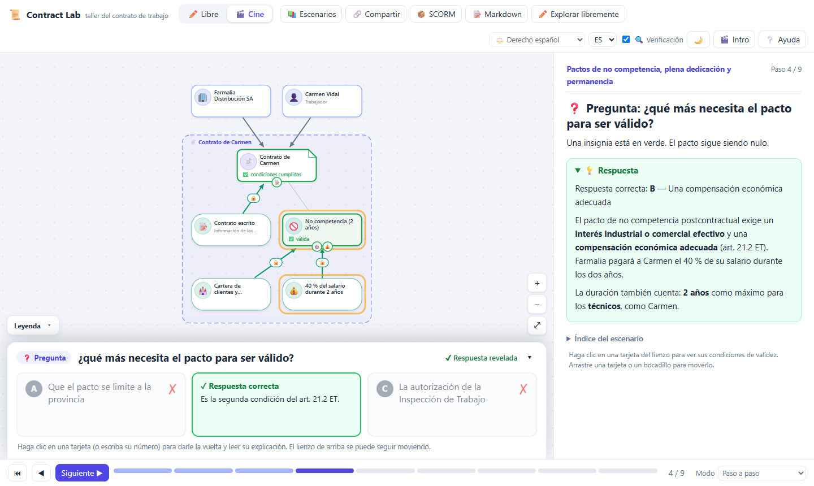
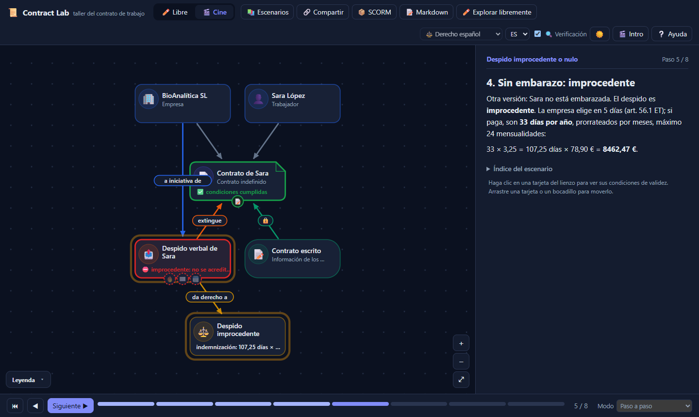

> 🌐 Esta es la documentación en español, que aplica el **derecho español**. Otras versiones: [Français](../README.md) · [English](../en/README.md).

# Contract Lab — taller del contrato de trabajo

**Contract Lab** es una herramienta didáctica para visualizar el **contrato de trabajo** y entender **qué hace válido un pacto, procedente un despido y a qué indemnizaciones da lugar** — en **derecho español**, pero también en derecho francés o inglés.

Cada elemento del derecho del trabajo se convierte en una tarjeta: el contrato y sus cláusulas, las **salvaguardas** que las condicionan, las **obligaciones** de las partes y sus **incumplimientos**, las **extinciones** y su procedimiento, las **indemnizaciones**. La herramienta lo verifica todo y muestra un veredicto: ✅ válido, ⚠️ en riesgo, ⛔ nulo o improcedente, ⚡ obligación incumplida. Un pacto de no competencia sin compensación económica adecuada se pone en rojo; un despido objetivo sin la indemnización puesta a disposición es improcedente; un despido improcedente muestra su indemnización de 33 días por año, con el tope de 24 mensualidades.

[▶ Abrir el taller](https://edu-fpar.github.io/contract-lab/es/ ':ignore') — en línea: **https://edu-fpar.github.io/contract-lab/es/**, también desde el móvil.

Modo cine, derecho español: el pacto de no competencia de Carmen se pone en verde al añadir la compensación económica; la pregunta a la clase acaba de revelarse.

Despido improcedente (tema oscuro): 33 días por año × 3,25 años = 107,25 días × 78,90 € = 8462,47 €.

## 🤖 Preparar la clase con una IA

<ol class="ai-steps">
<li><strong>Copie la consigna.</strong> Ya contiene el enlace a las instrucciones para la IA. El texto se puede modificar: adapte el público, el derecho o el número de pasos antes de copiarlo.

Lee las instrucciones en https://edu-fpar.github.io/contract-lab/docs/es/instructions-ia.md y prepara un escenario de Contract Lab a partir de la clase siguiente (o del archivo adjunto). Público: estudiantes de Relaciones Laborales o de Derecho (grado), de 6 a 8 pasos, con dos preguntas para la clase.

<button class="ai-btn big" data-copy-sel=".js-ia-prompt">📋 Copiar la consigna</button></li>
<li><strong>Péguela en su IA</strong> (ChatGPT, Claude, Gemini, Mistral, Copilot…) y añada su material de clase: texto pegado a continuación o archivo adjunto. La IA elige el derecho español (<code>droit: es</code>) o el francés según su curso.</li>
<li><strong>Copie la respuesta de la IA</strong> y péguela en el <a href="https://edu-fpar.github.io/contract-lab/es/?scenarios" target="_blank" rel="noopener">taller</a>: 🎬 Cine → 📚 Escenarios → Iniciar. Puede pegar la respuesta completa.</li>
</ol>

¿Su IA no puede abrir enlaces?

Copie entonces la versión completa: las instrucciones y la petición en un solo texto. Péguela en su IA y añada su material de clase.

<button class="ai-btn warn" data-copy-full="es/instructions-ia.md">📄 Copiar la versión completa</button> <a class="ai-link" href="es/instructions-ia.md" target="_blank" rel="noopener">ver las instrucciones</a>

💡 ¿Usa Claude? La <a href="#/es/ia-y-skill">skill de Contract Lab</a> comprueba además cada veredicto con el motor del taller.

ℹ️ Está leyendo esta documentación en local: la consigna apunta a la versión publicada, la que puede leer una IA en línea.

## Tres derechos

| | 🇪🇸 Derecho español | 🇫🇷 Derecho francés | 🇬🇧 Derecho inglés (Inglaterra y Gales) |
|---|---|---|---|
| Cómo elegirlo | encabezado `droit: es` al principio del escenario, o el selector de derecho del modo libre | el derecho por defecto | encabezado `droit: uk` |
| Abarca | contrato indefinido, temporales tras la reforma de 2021, sustitución, formativo, fijo-discontinuo, periodo de prueba, pactos del art. 21 ET (no competencia, plena dedicación, permanencia), jornada y registro, SMI, despido disciplinario y objetivo, despido colectivo, improcedencia y nulidad, dimisión, mutuo acuerdo, extinción de los arts. 50 y 41 ET, conciliación previa y caducidad | CDI, CDD, prueba, no competencia con contrapartida, movilidad, exclusividad, despido por motivo personal, falta grave, ruptura convencional, dimisión, *prise d'acte*, fuentes del derecho francés | relación laboral, *written statement*, *restrictive covenants*, *unfair dismissal*, *redundancy*, *settlement agreements*, Código ACAS |
| Cálculos | prueba máxima, duración de los pactos, 18 meses en 24, SMI (14 pagas), jornada, horas extra, vacaciones, indemnizaciones de 20, 33 y 12 días con prorrata por meses y topes, salarios de tramitación, prescripción de las faltas, caducidad, umbrales del despido colectivo, prestación por desempleo | prueba máxima, duración del CDD, preaviso e indemnización legales, mínimo de la ruptura convencional, indemnización de precariedad | véase la [documentación inglesa](../en/checking-rules.md) |

El catálogo español recoge el derecho vigente a **26 de noviembre de 2026** (Estatuto de los Trabajadores tras el RDL 32/2021, LRJS, LGSS) y señala con ⚠️ las cifras y los puntos a verificar (SMI 2026, jornada de 37,5 horas, régimen transitorio de los 45 días…). Véanse las [Reglas de verificación](reglas-de-verificacion.md).

## Dos maneras de usar el taller

| | Modo libre ✏️ | Modo cine 🎬 |
|---|---|---|
| Para quién | el docente que prepara, el estudiante que experimenta | la clase, durante la sesión; el estudiante que repasa en el móvil |
| Principio | construir con el ratón un contrato o un expediente de extinción, añadir las salvaguardas y leer los veredictos | un escenario en markdown reproduce la construcción paso a paso, con un comentario y preguntas para la clase |
| Ritmo | libre | paso a paso, o reproducción continua a velocidad ajustable |

Los dos modos comparten el mismo motor de verificación: condiciones de validez, incompatibilidades, obligaciones incumplidas, cálculos.

## Por dónde empezar

- **Descubrir**: abra el [taller en español](https://edu-fpar.github.io/contract-lab/es/?scenario=es-no-competencia ':ignore'), modo cine, escenario «Pactos de no competencia, plena dedicación y permanencia».
- **Presentar en clase**: [Modo cine](modo-cine.md), [escenarios disponibles](escenarios.md) y [enlaces para compartir](modo-cine.md#compartir-un-enlace).
- **Construir su propio contrato o expediente**: [Modo libre](primeros-pasos.md).
- **Escribir un escenario**: con una IA (arriba, o con la [skill](ia-y-skill.md)), o a mano con el [formato de los escenarios](formato-escenario.md).
- **Entender un veredicto sorprendente**: [Reglas de verificación](reglas-de-verificacion.md).

## Instalación

Ninguna. El taller es un conjunto de archivos HTML, CSS y JavaScript sin dependencias:
- en línea en **https://edu-fpar.github.io/contract-lab/es/** (o `?lang=es`);
- servido por un servidor web local (p. ej. `python -m http.server`, o UwAmp: `http://localhost/edu-fpar/contract-lab/?lang=es`);
- o abierto directamente con un doble clic en `index.html`.

El idioma de la interfaz se elige con `?lang=es` (o `?lang=fr`, `?lang=en`) y después se recuerda; el selector de la barra de herramientas también lo cambia. El botón 🌙 / ☀️ alterna entre el tema claro y el oscuro, aquí como en el taller.

Esta documentación necesita un servidor web y conexión a internet (usa [Docsify](https://docsify.js.org)). Sin ellos, sus páginas siguen siendo legibles tal cual: son los archivos `.md` de la carpeta `docs/es/`.

## Agradecimientos

Contract Lab reutiliza el motor de escenarios de **Capital Lab**, nacido de la herramienta ideada por **Tao** para mostrar a su clase de derecho financiero cómo una sociedad puede estar controlada por un accionista minoritario, y transmitida por **Yannick**. Muchas gracias a ambos.
