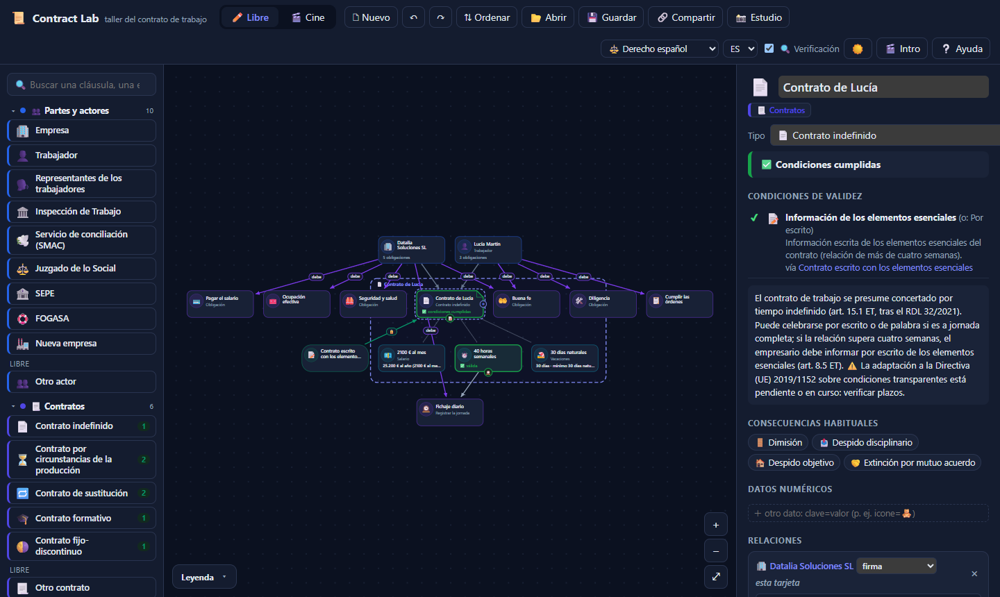

# Primeros pasos (modo libre)

El modo libre ✏️ sirve para construir un contrato o un expediente de extinción, añadir o quitar salvaguardas y observar el efecto en los veredictos. Ábralo en español con [`?lang=es`](https://edu-fpar.github.io/contract-lab/es/ ':ignore').

## La pantalla

- **a la izquierda**, la paleta: los elementos del derecho del trabajo, agrupados por familias, con un campo de búsqueda;
- **en el centro**, el lienzo;
- **a la derecha**, el inspector: propiedades y verificación del elemento seleccionado, o una vista de conjunto si no hay nada seleccionado.

El modo libre (tema oscuro), derecho español: la paleta a la izquierda, un contrato de ejemplo en el centro y, a la derecha, el inspector con el veredicto y las condiciones de validez del elemento seleccionado.

El **selector de derecho** de la barra de herramientas elige el catálogo: derecho español, derecho francés o derecho inglés (Inglaterra y Gales). El selector de idioma cambia la interfaz entre español, francés e inglés. El botón 🌙 / ☀️ alterna entre el tema **claro** y el **oscuro**; por defecto el taller sigue el ajuste del sistema, y la elección se recuerda en el navegador.

## La paleta

Los elementos se agrupan en diez familias, cada una con su color. Ejemplos en derecho español:

| Familia | Ejemplos |
|---|---|
| 👥 Partes y actores | empresa, trabajador, representantes de los trabajadores, Inspección de Trabajo, servicio de conciliación (SMAC), Juzgado de lo Social, SEPE, FOGASA, nueva empresa |
| 📃 Contratos | indefinido, por circunstancias de la producción, de sustitución, formativo, fijo-discontinuo |
| 🧩 Cláusulas | contenido básico (salario, jornada, tiempo parcial, horas extraordinarias, vacaciones, periodo de prueba), pactos del art. 21 ET (no competencia, permanencia, plena dedicación, confidencialidad), cláusulas nulas (renuncia a derechos, cláusula discriminatoria) |
| 🔒 Salvaguardas y condiciones | por escrito, información de los elementos esenciales, causa temporal precisa, interés industrial o comercial efectivo, compensación económica adecuada, especialización costeada, causas ETOP, hechos concretos y fecha de efectos, voluntad clara, consentimiento libre; hechos relevantes (funciones previas, embarazo, vulneración de derechos fundamentales) |
| 📌 Obligaciones | del empresario (pagar el salario, ocupación efectiva, seguridad y salud, no discriminación, dignidad e intimidad, registrar la jornada), del trabajador (diligencia, cumplir las órdenes, no concurrencia desleal, observar la prevención), buena fe |
| ⚡ Faltas e incumplimientos | incumplimiento, incumplimiento grave y culpable, faltas de asistencia, desobediencia, ofensas, transgresión de la buena fe, disminución del rendimiento, acoso, ineptitud, impago de salarios, incumplimiento grave del empresario |
| 💔 Extinción del contrato | despido disciplinario, objetivo y colectivo, desistimiento en periodo de prueba, fin del contrato temporal, dimisión, mutuo acuerdo, extinción por incumplimiento del empresario (art. 50 ET), rescisión por modificación sustancial (art. 41 ET) |
| 🔹 Procedimiento | carta de despido, indemnización puesta a disposición, preaviso, expediente contradictorio, periodo de consultas, comunicación a la autoridad laboral, modificación sustancial, conciliación previa, demanda, finiquito |
| 🎁 Indemnizaciones y derechos | indemnización por despido, despido improcedente, despido nulo, indemnización por fin de contrato, salarios de tramitación, vacaciones no disfrutadas, prestación por desempleo |
| 📚 Fuentes del derecho | Estatuto de los Trabajadores, reforma laboral de 2021, convenio colectivo, LRJS, Ley de prevención de riesgos laborales, LGSS, Constitución |

En derecho francés o inglés, las mismas familias contienen el catálogo correspondiente, con etiquetas en español cuando existe la traducción.

El pequeño número a la derecha de un elemento es su número de **condiciones de validez**; un **!** señala una cláusula ilícita por naturaleza. Pase el ratón por encima de un elemento para leer su descripción. El campo **🔍 Buscar** filtra la paleta («prueba», «despido», «pacto»…). Cada familia tiene también un elemento **libre** («Otra cláusula», «Otra condición»…) para una noción que falte en el catálogo.

## Construir un contrato

1. **Añadir un elemento**: arrástrelo desde la paleta hasta el lienzo, o haga clic en él para añadirlo en el centro de la vista. Cámbiele el nombre en el inspector («Contrato de Carmen», «No competencia 2 años»…).
2. **Unir dos elementos**: pase el ratón por encima de una tarjeta y arrastre el asa **+** de su derecha hasta la otra tarjeta. La relación se elige según los tipos: un trabajador **firma** un contrato, un contrato **contiene** una cláusula, una salvaguarda **limita** una cláusula, una falta **justifica** una extinción, una extinción **da derecho** a una indemnización, dos trámites se suceden con **luego**. Puede cambiarla en el inspector y añadirle una etiqueta («15 días», «20 días hábiles»…).
3. **Añadir y unir a la vez**: con una tarjeta seleccionada, un clic en la paleta añade el elemento **a su lado y unido a ella**. Un trámite de procedimiento se añade al final de la cadena existente.
4. **Introducir las cifras**: en el trabajador, `antiguedad` (años, con decimales), `salario` (bruto mensual con prorrata de pagas extra) y `categoria` (`tecnico_titulado`, `tecnico` u otro); en la empresa, `plantilla`; en un periodo de prueba, un pacto o un contrato temporal, la `duracion` en meses; en un despido, `afectados`. Los cálculos las encuentran en el expediente.

Las cláusulas unidas a un contrato (y sus salvaguardas) quedan rodeadas por un **marco 📄** con el nombre del contrato: se ve de un vistazo lo que contiene. En el inspector, la lista «＋ Unir con…» también crea una relación sin pasar por el lienzo.

## Leer los veredictos y las pastillas

| Veredicto | Significado |
|---|---|
| ✅ válido (o «procedente», «condiciones cumplidas») | se cumplen todas las condiciones de validez |
| ⚠️ en riesgo | falta una condición menos grave (información escrita, preaviso, comunicación a la autoridad laboral, conciliación previa…) |
| ⛔ nulo / improcedente | falta una condición esencial, la cláusula es ilícita, hay un elemento incompatible en el expediente o un cálculo supera un límite legal |
| ⚡ incumplida | una obligación unida a un incumplimiento |

Bajo la tarjeta, las **pastillas** son sus salvaguardas: **verdes** si están presentes, **punteadas** (rojas o naranjas) si faltan. Pase el ratón por encima de una pastilla para leer la condición.

Al seleccionar la tarjeta, el inspector detalla:
- el **veredicto**, con el efecto preciso («nulo (art. 21.2.b ET)», «improcedente: despido sin carta (art. 55.1 y 55.4 ET)»…) y las **incompatibilidades** (⊘) encontradas en el expediente;
- los **cálculos** (🧮): duración máxima de la prueba, indemnizaciones con su prorrata por meses y su tope, SMI, salarios de tramitación, plazos de prescripción y de caducidad, umbrales del despido colectivo, duración de la prestación por desempleo;
- la lista de **Condiciones de validez**: cada condición, su justificación y lo que ocurre si falta («Si no: …»);
- la descripción jurídica del elemento, sus **incompatibilidades** previstas y sus **consecuencias habituales** (para una extinción: finiquito, indemnización, prestación por desempleo, conciliación previa…).

## ＋ Añadir una salvaguarda que falta

En la lista de condiciones, cada condición no cumplida tiene un botón **＋**: añade la salvaguarda esperada y la une a la tarjeta. La pastilla se pone verde, y el veredicto cambia si era la última condición que faltaba. Del mismo modo, un clic en una **consecuencia habitual** la añade y la une.

Es la forma más rápida de construir un pacto válido: ponga la cláusula sola (⛔, pastillas punteadas) y pulse los botones ＋ uno a uno.

## Veredicto y condiciones personalizados

Cuando la herramienta no conoce una regla, la sección desplegable «Veredicto y condiciones personalizados» del inspector permite:
- **imponer un veredicto** (válido, en riesgo, nulo, incumplido, sin veredicto) con un texto;
- añadir **condiciones libres** («Limitada a 1 año»), marcadas o no, que se muestran como pastillas igual que las demás.

## Zoom en un expediente

Un **expediente** agrupa los elementos unidos entre sí en torno a un contrato o a una extinción (véanse las [Reglas de verificación](reglas-de-verificacion.md#expediente-e-incompatibilidades)). El botón **🔎 Zoom en su expediente** del inspector, o la lista de la vista de conjunto, atenúa todo lo demás. Un aviso en la parte superior del lienzo lo recuerda; su cruz restablece la vista completa.

## La casilla «🔍 Verificación»

Arriba a la derecha. Desmarcada, **oculta los veredictos y las pastillas**: las tarjetas quedan neutras y la lista de condiciones muestra ❔. La clase decide si el pacto es válido; vuelva a marcarla para revelar la respuesta. El ajuste se guarda con la construcción y el estudio lo captura.

## Atajos

| Acción | Gesto o tecla |
|---|---|
| Zoom | rueda del ratón, o botones + / − |
| Desplazar | arrastrar el fondo |
| Verlo todo | **F**, o botón ⤢ |
| Borrar la selección | **Supr** |
| Deshacer / rehacer | **Ctrl+Z** / **Ctrl+Y** |
| Deseleccionar | **Esc** |

## Guardar, abrir, ordenar

- **💾 Guardar** descarga la construcción en `.json`; **📂 Abrir** la vuelve a cargar (o abre un escenario `.md`). También se puede soltar un archivo sobre la ventana.
- **🔗 Compartir** da un enlace que contiene la construcción (codificada tras el `#`, ningún servidor la recibe), en el idioma elegido, con o sin los veredictos: envíelo a los estudiantes o a un colega. El enlace abre el esquema en modo libre; **Ctrl+Z** recupera el lienzo que tenía antes.
- El trabajo en curso se conserva automáticamente en el navegador.
- **⇅ Ordenar** dispone las tarjetas automáticamente: partes arriba, contratos, después cláusulas y salvaguardas; las cadenas de procedimiento («luego») en una fila, de izquierda a derecha.
- **🗋 Nuevo** vacía el lienzo.

## El estudio 📸: convertir una construcción en escenario

1. pulse **📸 Estudio**;
2. construya el primer paso y pulse **📸 Capturar el paso**: dele un título y un comentario (markdown). Si hay una tarjeta seleccionada, puede resaltarse;
3. modifique la construcción (añada una salvaguarda, un trámite, desmarque la verificación para plantear una pregunta…), capture el paso siguiente, y así sucesivamente;
4. **▶ Vista previa** lo reproduce en modo cine; **⬇ Exportar .md** produce el archivo del escenario (con `droit: es` si el derecho es el español).

La exportación calcula los comandos que llevan de un paso al siguiente. Para convertir un paso en pregunta para la clase, añada después al markdown las opciones `- [ ]` / `- [x]` (véase el [formato de los escenarios](formato-escenario.md#pasos-pregunta-quiz)).
