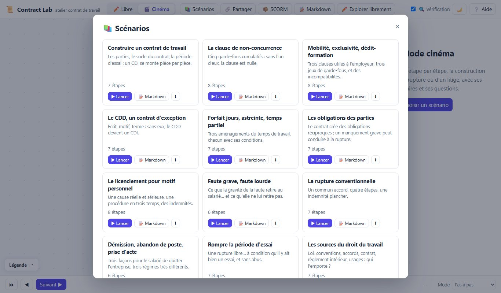
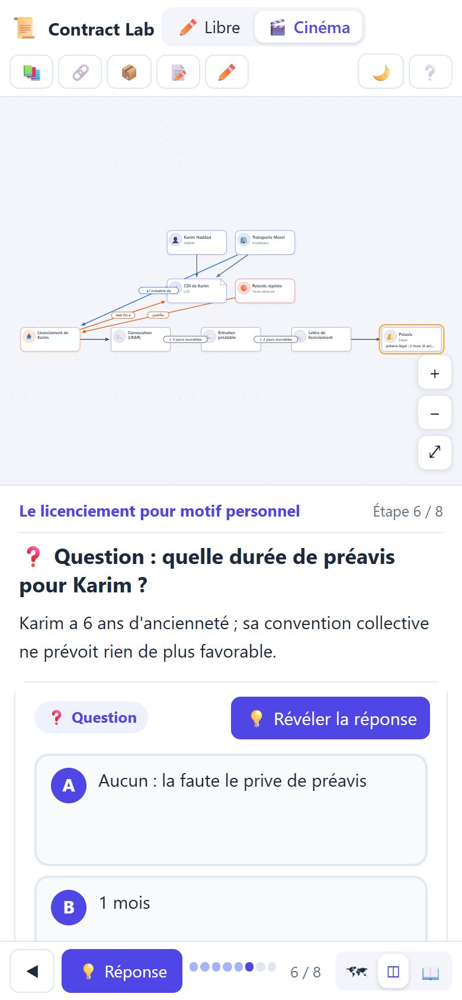
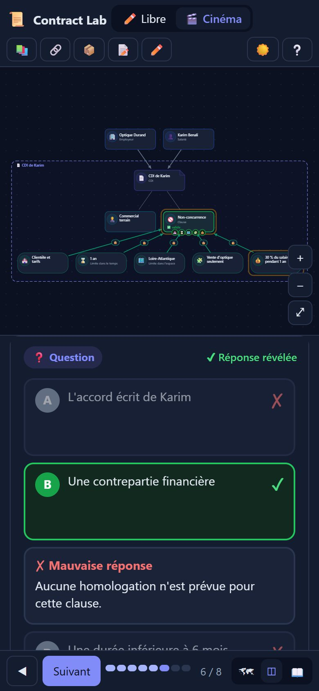
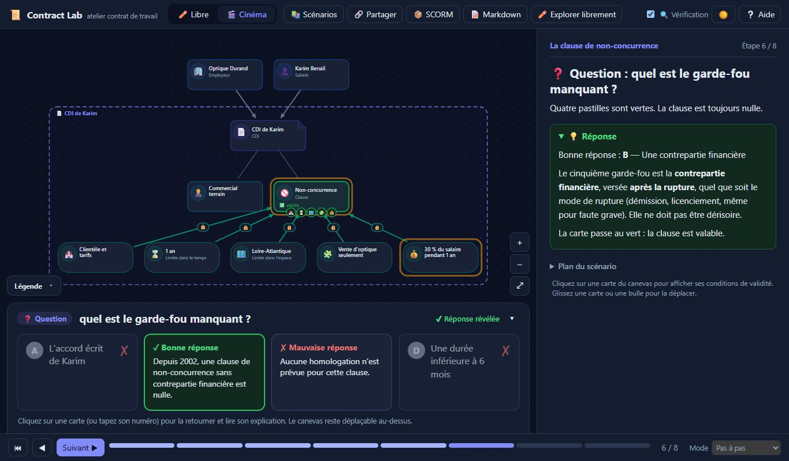

# Mode cinéma

Le mode cinéma 🎬 déroule un **scénario** : à chaque étape, le canevas s'anime (cartes qui apparaissent, liens qui se tracent, pastilles qui passent au vert, bulles et mises en évidence) et le panneau de droite affiche le commentaire.

## Charger un scénario

Bouton **📚 Scénarios** :
- choisir un scénario de la bibliothèque ([liste](scenarios.md)) ;
- ou **coller** le markdown fourni par un collègue ou une IA, puis « ▶ Lancer » ;
- ou **ouvrir un fichier** `.md`. On peut aussi le déposer directement sur la fenêtre.

La bibliothèque : les scénarios intégrés, et la zone où coller un scénario écrit par un collègue ou une IA.

## Partager un lien

L'atelier est en ligne à l'adresse **https://edu-fpar.github.io/contract-lab/**. Le bouton **🔗 Partager** propose trois liens à copier : vers **l'étape affichée**, vers **le début du scénario**, ou vers **la bibliothèque**. Pendant la lecture, l'adresse du navigateur suit d'ailleurs l'étape en cours : on peut aussi la copier directement.

| Lien | Ouvre |
|---|---|
| `…/contract-lab/?scenarios` | la bibliothèque des scénarios |
| `…/contract-lab/?scenario=non-concurrence` | un scénario intégré, à sa première étape |
| `…/contract-lab/?scenario=non-concurrence&etape=6` | ce scénario, directement à l'étape 6 (la question) |
| `…/contract-lab/?md=adresse-du-fichier.md` | un scénario publié sous forme de fichier |
| `…/contract-lab/#md=…` | un scénario personnel (collé ou généré par une IA), dont le texte est encodé dans le lien |

Pour un scénario personnel, le lien contient le texte compressé du scénario après le `#` : il n'est envoyé à aucun serveur et fonctionne sans rien publier. Pour un très long scénario, le lien peut devenir trop long pour certaines messageries : publiez plutôt le fichier `.md` et utilisez `?md=`. Dans tous les cas, `&etape=N` choisit l'étape d'arrivée (l'introduction, si le scénario en a une, compte comme étape 1).

## Exporter en SCORM (Moodle)

Le bouton **📦 SCORM** produit un paquet `.zip` à déposer dans Moodle (activité « Paquetage SCORM ») ou dans toute plateforme compatible SCORM. Le paquet contient l'atelier et le scénario affiché, y compris un scénario personnel ou modifié : les élèves le suivent seuls, en pas à pas, sans connexion au site.

- **Version** : SCORM 1.2 (recommandé pour Moodle) ou SCORM 2004 4ᵉ édition.
- **Achèvement** : l'activité est « terminée » quand l'élève atteint la dernière étape.
- **Reprise** : en revenant, l'élève reprend à l'étape où il s'était arrêté.
- **Note** (facultative, si le scénario a des questions à choix) : sur 100, la part des questions où l'élève a cliqué une bonne carte *avant* de révéler la réponse. Seule la première tentative compte.

Dans le paquet, seul le lecteur reste visible : pas de mode libre, de bibliothèque ni de partage. Le paquet se construit à partir des fichiers de l'atelier : depuis un fichier ouvert par double-clic, il les récupère sur le site en ligne.

## Sur téléphone

L'atelier s'adapte aux écrans étroits. Sur téléphone, il s'ouvre directement sur la bibliothèque des scénarios :

 

- le **schéma** occupe le haut de l'écran, les **explications** le bas ;
- les boutons **🗺 / ◫ / 📖** de la barre du bas affichent le schéma seul, les deux, ou le texte seul ;
- on **balaie** les explications vers la gauche ou la droite pour changer d'étape ; les boutons **◀ / Suivant** restent disponibles ;
- on **pince** le schéma pour zoomer, on le fait glisser pour se déplacer, et on touche une carte pour afficher son verdict et ses conditions de validité sous le texte ;
- les **questions** s'affichent dans le texte, avec les choix empilés : toucher un choix pour indiquer sa réponse, « Révéler la réponse », puis toucher une carte pour la retourner.

Le mode libre reste accessible, mais il est conçu pour un écran plus large.

## Pas à pas ou lecture continue

En bas de l'écran :

| Contrôle | Effet |
|---|---|
| ⏮ ◀ | revenir au début, ou à l'étape précédente |
| Suivant ▶ | étape suivante |
| barres de progression | cliquer sur une barre pour aller à cette étape |
| Mode **Pas à pas** | c'est l'utilisateur qui avance |
| Mode **Lecture continue** | les étapes s'enchaînent ; ▶ / ⏸ pour lancer ou mettre en pause |
| Rythme | de 0,25× à 3× |

En lecture continue, la durée d'une étape dépend de la longueur de son commentaire (entre 5 et 45 secondes à vitesse 1×), sauf si le scénario la fixe avec `duree`. Une fine barre orange montre le temps restant.

Clavier : **→** / **←** pour avancer ou reculer, **Espace** pour avancer (pas à pas) ou faire lecture/pause (continu), **Origine** / **Fin** pour la première et la dernière étape, **F** pour recadrer.

## Étapes questions

Certaines étapes interrogent l'audience. Leur titre est précédé de ❓, et une fenêtre monte en bas du canevas avec la question et les choix en grandes cartes (A, B, C…).

Après la révélation : la bonne carte en vert, une carte retournée pour lire son explication, et la clause passée au vert sur le canevas.

1. **Laisser la salle répondre** : à main levée, à l'oral… Cliquez sur la carte choisie par la majorité, ou tapez son numéro : elle est marquée « 👥 choix de la salle ».
2. **Révéler la réponse** : bouton « 💡 Révéler la réponse », touche **→**, ou bouton « 💡 Réponse ▶ » de la barre du bas. Une télécommande de présentation fonctionne donc : un premier appui révèle, le suivant passe à l'étape d'après.
3. **Commenter chaque choix** : les bonnes réponses passent au vert, les autres s'estompent. Cliquez sur une carte, ou tapez son numéro, pour la **retourner** et lire pourquoi ce choix est juste ou faux.
4. **L'explication générale** s'ouvre dans le panneau de droite, en accordéon. La réponse peut aussi modifier le canevas : verdicts rétablis, garde-fou ajouté, mise en évidence, bulle.

La fenêtre ne masque pas le schéma : le canevas se recadre automatiquement au-dessus d'elle, il reste déplaçable et zoomable, et le bouton **▾** réduit la fenêtre à une simple barre. En lecture continue, le défilement s'arrête sur une question jusqu'à la révélation, puis reprend.

Une question est en général précédée de `verification off` : les verdicts et les pastilles sont masqués, pour que le canevas ne donne pas la réponse ; la réponse les rétablit avec `verification on`. Pour écrire une question, voir le [format des scénarios](format-scenario.md#étapes-questions).

## Interagir pendant la présentation

- **Cliquer sur une carte** affiche sa vérification complète sous le commentaire : verdict, calculs, conditions de validité, conséquences habituelles.
- **Survoler un nom** surligné dans le commentaire met en évidence la carte correspondante ; cliquer dessus la sélectionne.
- **Déplacer une carte ou une bulle** : glissez-la. C'est utile quand des bulles se chevauchent ou masquent un lien. Les déplacements sont conservés d'une étape à l'autre. Le bouton **↺ Disposition** remet tout à la place prévue par le scénario. Ces déplacements ne modifient pas le scénario lui-même.
- Le panneau « Plan du scénario » permet de sauter à n'importe quelle étape.

## Modifier ou réutiliser

- **📝 Markdown** ouvre le texte du scénario : on peut le corriger et l'appliquer en restant à la même étape, le copier ou le télécharger.
- **✏️ Explorer librement** recopie l'état affiché dans le mode libre, pour le manipuler (retirer un garde-fou, ajouter une faute grave, changer l'ancienneté…).

Si un scénario contient des commandes non comprises, un avertissement apparaît sous le commentaire, avec le numéro de ligne.
