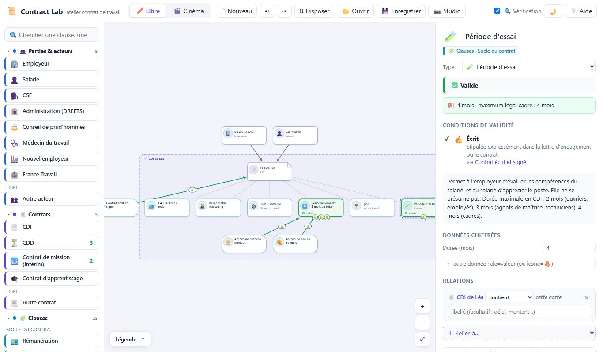

# Prise en main (mode libre)

Le mode libre ✏️ sert à construire un contrat ou un dossier de rupture, à ajouter ou retirer des garde-fous et à observer l'effet sur les verdicts.

## L'écran

- **à gauche**, la palette : les éléments du droit du travail, classés par familles, avec un champ de recherche ;
- **au centre**, le canevas ;
- **à droite**, l'inspecteur : propriétés et vérification de l'élément sélectionné, ou vue d'ensemble si rien n'est sélectionné.

La palette à gauche, le contrat au centre, l'inspecteur à droite : verdict, calcul de durée et conditions de validité de la période d'essai.

Le bouton 🌙 / ☀️ en haut à droite bascule entre le **mode jour** et le **mode nuit**. Par défaut, l'atelier suit le réglage du système ; une fois choisi, le mode est mémorisé dans le navigateur.

## La palette

Les éléments sont rangés en dix familles, chacune avec sa couleur :

| Famille | Exemples |
|---|---|
| 👥 Parties & acteurs | employeur, salarié, CSE, administration (DREETS), conseil de prud'hommes, médecin du travail, France Travail |
| 📃 Contrats | CDI, CDD, contrat de mission (intérim), contrat d'apprentissage |
| 🧩 Clauses | socle du contrat (rémunération, fonctions, durée du travail, période d'essai…), clauses particulières (non-concurrence, mobilité, exclusivité, dédit-formation, forfait en jours…), clauses illicites |
| 🔒 Garde-fous & conditions | contrepartie financière, limites dans le temps et l'espace, intérêt légitime, écrit, motif de recours, cause réelle et sérieuse… |
| 📌 Obligations | de l'employeur, du salarié, des deux parties |
| ⚡ Fautes & manquements | manquement, faute sérieuse, faute grave, faute lourde, harcèlement, insuffisance professionnelle |
| 💔 Ruptures du contrat | démission, licenciements, rupture conventionnelle, fin et rupture anticipée du CDD, rupture de l'essai, prise d'acte, abandon de poste… |
| 🔹 Procédure | convocation, entretien préalable, lettre de licenciement, préavis, étapes de la rupture conventionnelle, reclassement… |
| 🎁 Indemnités & droits | indemnité de licenciement, de préavis, de congés payés, de fin de CDD, de rupture conventionnelle, allocation chômage, dommages-intérêts |
| 📚 Normes | Code du travail, convention de branche, accord d'entreprise, règlement intérieur, usage |

Le petit chiffre à droite d'un élément indique son nombre de **conditions de validité** ; un **!** signale une clause illicite par nature. Survolez un élément pour lire sa description. Le champ **🔍 Chercher** filtre la palette (« essai », « préavis », « faute »…).

Chaque famille a aussi un élément **libre** (« Autre clause », « Autre condition »…) pour représenter une notion absente du catalogue.

## Construire un contrat

1. **Ajouter un élément** : glissez-le depuis la palette sur le canevas, ou cliquez dessus pour l'ajouter au centre de la vue. Renommez-le dans l'inspecteur (« CDI de Karim », « Non-concurrence 1 an »…).
2. **Relier deux éléments** : survolez une carte, puis tirez la poignée **+** située à sa droite jusqu'à l'autre carte. La relation est choisie d'après les types : un salarié **signe** un contrat, un contrat **contient** une clause, un garde-fou **encadre** une clause, une faute **justifie** une rupture, une rupture **ouvre droit à** une indemnité, deux étapes de procédure s'enchaînent par **puis**. On peut la changer dans l'inspecteur, et ajouter un libellé (« 5 jours ouvrables », « 30 % du salaire »…).
3. **Ajouter et relier d'un coup** : avec une carte sélectionnée, un clic dans la palette ajoute l'élément **à côté et le relie** à la carte. Une étape de procédure s'ajoute au bout de la chaîne existante.
4. **Renseigner les données chiffrées** : sur le salarié, la **catégorie**, l'**ancienneté** (en années) et le **salaire** mensuel brut ; sur une période d'essai ou un CDD, la **durée** en mois ; sur une indemnité de rupture conventionnelle, le **montant**. Les calculs les retrouvent dans le dossier.

Les clauses reliées à un contrat (et leurs garde-fous) sont entourées d'un **cadre 📄** au nom du contrat : on voit d'un coup d'œil ce que contient le contrat.

Dans l'inspecteur, la liste « ＋ Relier à… » crée aussi une relation sans passer par le canevas.

## Lire les verdicts et les pastilles

Chaque carte affiche son **verdict** sur sa dernière ligne :

| Verdict | Sens |
|---|---|
| ✅ valide (ou « régulière », « conditions remplies ») | toutes les conditions de validité sont remplies |
| ⚠️ à risque | une condition de moindre gravité manque (irrégularité de procédure, mise en œuvre abusive…) |
| ⛔ nulle / irrégulière | une condition essentielle manque, la clause est illicite, ou un élément incompatible est présent dans le dossier |
| ⚡ violée | une obligation à laquelle est relié un manquement |

Sous la carte, les **pastilles** sont ses garde-fous : **vertes** si le garde-fou est présent, **en pointillés** (rouges ou orange) s'il manque. Survolez une pastille pour lire la condition.

En sélectionnant la carte, l'inspecteur détaille :
- le **verdict**, avec l'effet précis (« requalification en CDI », « inopposable au salarié », « non due en cas de faute grave »…) et les **incompatibilités** (⊘) constatées dans le dossier ;
- les **calculs** (🧮) : durée maximale de l'essai, durée du CDD, préavis légal, indemnité légale avec sa formule, prime de précarité ;
- la checklist **Conditions de validité** : chaque condition, sa justification, et ce qui se passe si elle manque (« Sinon : nulle ») ;
- la description juridique de l'élément ;
- les **Incompatibilités** prévues par le catalogue et les **Conséquences habituelles** (pour une rupture : préavis, indemnités, chômage, documents de fin de contrat).

## ＋ Ajouter un garde-fou manquant

Dans la checklist, chaque condition non remplie a un bouton **＋** : il ajoute le garde-fou attendu et le relie à la carte. La pastille passe au vert, et le verdict change si c'était la dernière condition manquante. De même, un clic sur une **conséquence habituelle** l'ajoute et la relie (une indemnité est reliée par « ouvre droit à »).

C'est la manière la plus rapide de construire une clause valable : posez la clause seule (⛔ nulle, pastilles en pointillés), puis cliquez sur les ＋ un par un.

## Verdict et conditions personnalisés

Quand l'outil ne connaît pas une règle, la section repliable « Verdict et conditions personnalisés » de l'inspecteur permet :
- d'**imposer un verdict** (valide, à risque, nulle, violée, sans verdict) avec un texte ;
- d'ajouter des **conditions libres** (« Limitée à 1 an »), cochées ou non, qui s'affichent en pastilles comme les autres.

## Zoom sur un dossier

Un **dossier** regroupe les éléments reliés entre eux autour d'un contrat ou d'une rupture (voir [Règles de vérification](regles-de-calcul.md#dossier-et-incompatibilités)). Le bouton **🔎 Zoom sur son dossier** de l'inspecteur, ou la liste « Zoom sur un dossier » de la vue d'ensemble, estompe tout le reste. Un bandeau en haut du canevas le rappelle ; sa croix rétablit l'affichage complet.

## La case « 🔍 Vérification »

En haut à droite. Décochée, elle **masque les verdicts et les pastilles** : les cartes restent neutres et la checklist affiche des ❔. La classe juge elle-même si la clause est valable ; on recoche pour révéler la réponse. Le réglage est enregistré avec la construction, et capturé par le studio.

## La vue d'ensemble

Sans sélection, l'inspecteur compte les éléments ✅ valides, ⚠️ à risque, ⛔ nuls et ⚡ violés, liste les **points à corriger** et les **contrats** avec leurs clauses. **✨ Charger un exemple** charge le premier scénario de la bibliothèque (« Construire un contrat de travail ») dans son état final.

## Raccourcis

| Action | Geste ou touche |
|---|---|
| Zoomer | molette, ou boutons + / − |
| Déplacer la vue | glisser le fond |
| Tout afficher | **F**, ou bouton ⤢ |
| Supprimer la sélection | **Suppr** |
| Annuler / rétablir | **Ctrl+Z** / **Ctrl+Y** |
| Désélectionner | **Échap** |

## Enregistrer, ouvrir, réorganiser

- **💾 Enregistrer** télécharge la construction au format `.json` ; **📂 Ouvrir** la recharge (ou ouvre un scénario `.md`). Un fichier peut aussi être déposé sur la fenêtre.
- Le travail en cours est conservé automatiquement dans le navigateur.
- **⇅ Disposer** range automatiquement les cartes : les parties en haut, les contrats, puis les clauses et leurs garde-fous ; les chaînes de procédure (« puis ») sur une même rangée, de gauche à droite.
- **🗋 Nouveau** vide le canevas.

## Le studio 📸 : transformer une construction en scénario

Le studio permet de préparer un scénario à la souris :
1. cliquez sur **📸 Studio** ;
2. construisez la première étape, puis **📸 Capturer l'étape** : donnez un titre et un commentaire (en markdown). Si une carte est sélectionnée, elle peut être mise en évidence ;
3. modifiez la construction (ajoutez un garde-fou, une étape de procédure, décochez la vérification pour poser une question…), capturez l'étape suivante, et ainsi de suite ;
4. **▶ Prévisualiser** la lit en mode cinéma ; **⬇ Exporter .md** produit le fichier du scénario.

L'export calcule automatiquement les commandes qui font passer d'une étape à la suivante. Pour transformer une étape en question à la salle, ajoutez ensuite les choix `- [ ]` / `- [x]` dans le markdown (voir le [format des scénarios](format-scenario.md#étapes-questions)).
