# Visuels de Contract Lab

Tous les visuels de communication, **dans les trois langues**, prêts à réutiliser : aperçus de partage (Open Graph), posts LinkedIn / Facebook / Instagram / Mastodon / Bluesky / X, stories, illustrations d'articles et de README.

**Ne pas les refaire à la main** : tout se régénère d'une commande, depuis le dossier du projet.

```bash
node tools/screenshots.js visuels          # captures de l'application + mises en scène, 3 langues
node tools/screenshots.js compo            # seulement les mises en scène (après retouche des textes)
ONLY=visuels/es node tools/screenshots.js visuels   # une seule langue
```

- Les **textes** des visuels (titre, accroche, pastilles, adresse) sont dans `tools/visuels.html` (objet `T`, une entrée par langue).
- Les **scénarios montrés** (vitrines de chaque langue) et les **formats** sont dans `tools/screenshots.js` (`SHOW`, `FORMATS`).
- Pour une nouvelle langue : une entrée dans `T` et dans `SHOW`, puis la commande.

## Organisation

```
visuels/
├── README.md                ← ce fichier : catalogue, usages, textes de posts
├── fr/                      ← français, droit français
│   ├── og.png               1200 × 630   aperçu de lien (balise og:image du site)
│   ├── carre.png            1080 × 1080  post carré (Instagram, LinkedIn, Facebook)
│   ├── portrait.png         1080 × 1350  post portrait (Instagram, LinkedIn mobile)
│   ├── story.png            1080 × 1920  story, réel, short (vue téléphone)
│   └── captures/            captures brutes de l'application (README, articles, diapositives)
│       ├── cinema-question.png      1440 × 860  mode cinéma, question révélée (jour)
│       ├── cinema-rupture-nuit.png  1440 × 860  une rupture et ses indemnités (nuit)
│       ├── libre-nuit.png           1440 × 860  mode libre, analyse d'une clause (nuit)
│       └── telephone-question.png    780 × 1688 vue téléphone, question à la salle
├── en/                      ← anglais, droit anglais (même structure)
└── es/                      ← espagnol, droit espagnol (même structure)
```

Les captures de la **documentation** restent dans `docs/images/` (JPEG légers, `node tools/screenshots.js doc`).
Les **vidéos** de la visite guidée (exports 9:16 et sous-titres `.srt`) sont dans `canva-video-exports/`, non versionnées (trop lourdes) : la visite elle-même est en ligne sur `intro.html`.
`contract-lab.png` (racine) est l'ancien aperçu de partage : conservé pour les liens déjà publiés, il n'est plus régénéré.

## Liens à partager (l'aperçu suit la langue)

Les réseaux sociaux n'exécutent pas le JavaScript : chaque langue a donc sa propre page d'entrée avec ses balises Open Graph et son image, qui renvoie ensuite vers l'application dans la bonne langue (en gardant `?scenario=…&etape=…`).

| Langue | Lien à partager | Image d'aperçu |
|---|---|---|
| Français | https://edu-fpar.github.io/contract-lab/ | `visuels/fr/og.png` |
| English | https://edu-fpar.github.io/contract-lab/en/ | `visuels/en/og.png` |
| Español | https://edu-fpar.github.io/contract-lab/es/ | `visuels/es/og.png` |

Un scénario précis : `…/contract-lab/en/?scenario=uk-covenants&etape=5` garde l'aperçu anglais. Le bouton **🔗 Partager** de l'application construit ces liens selon la langue choisie.
Après une mise à jour de l'image, forcer la relecture : [LinkedIn Post Inspector](https://www.linkedin.com/post-inspector/), [Facebook Sharing Debugger](https://developers.facebook.com/tools/debug/).

## Aperçu

| | Français | English | Español |
|---|---|---|---|
| og | 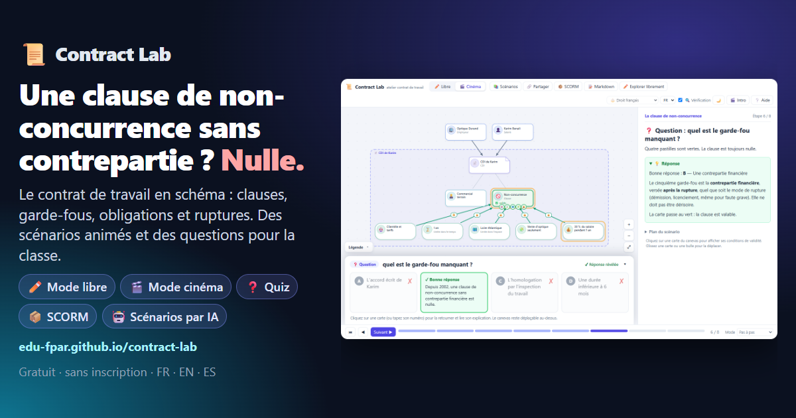 | 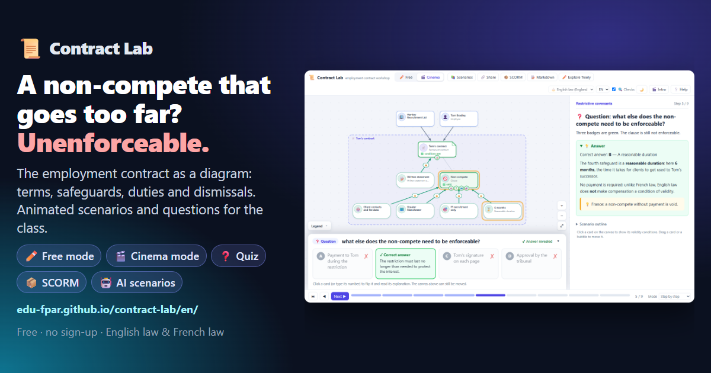 | 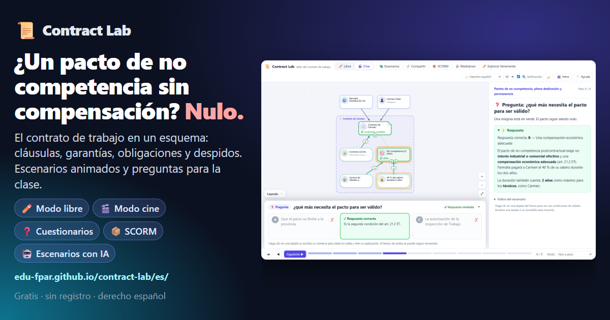 |
| carré | 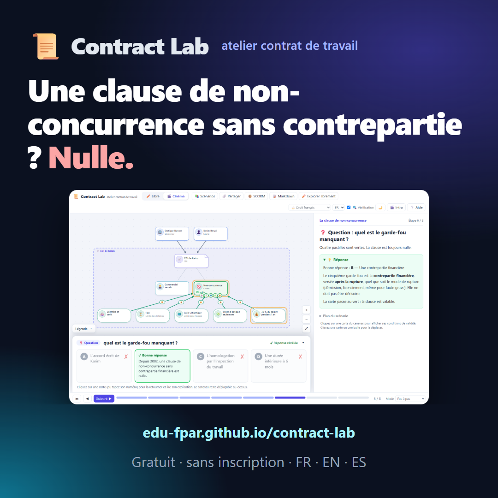 | 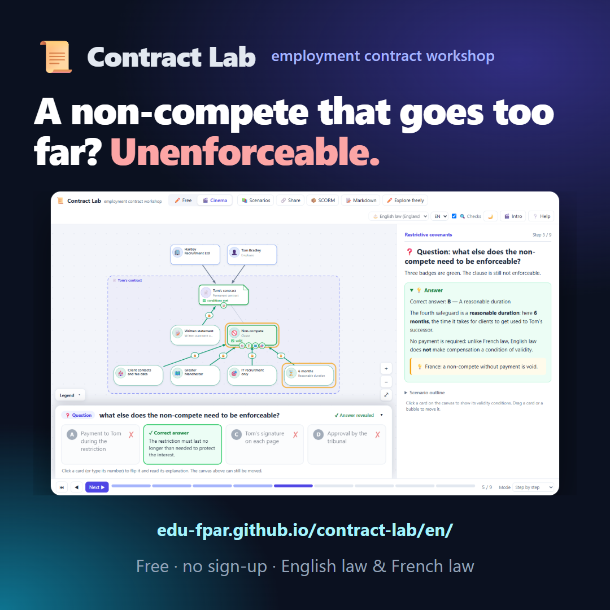 | 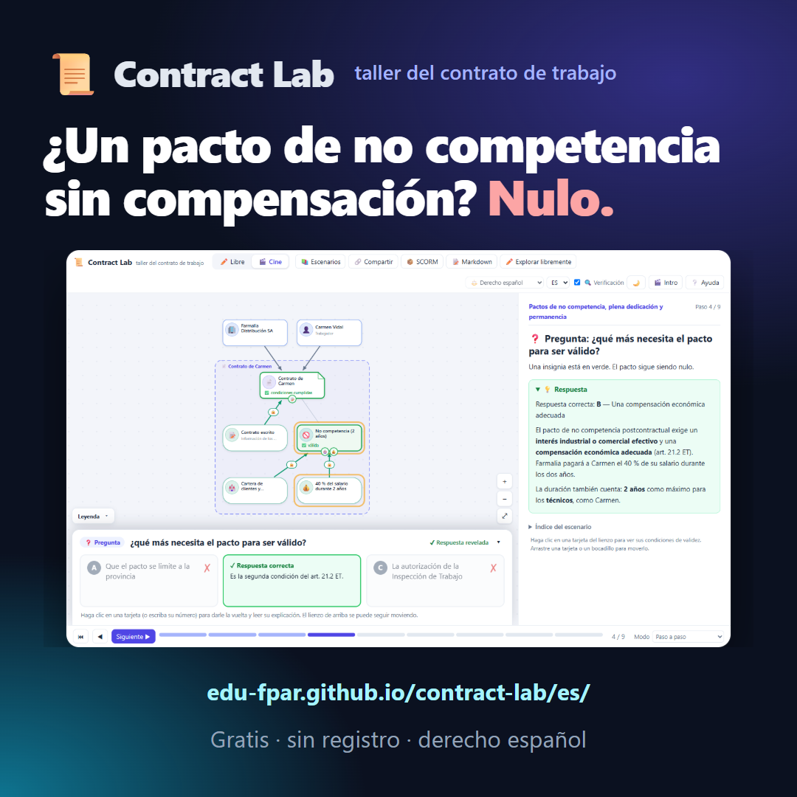 |
| portrait | 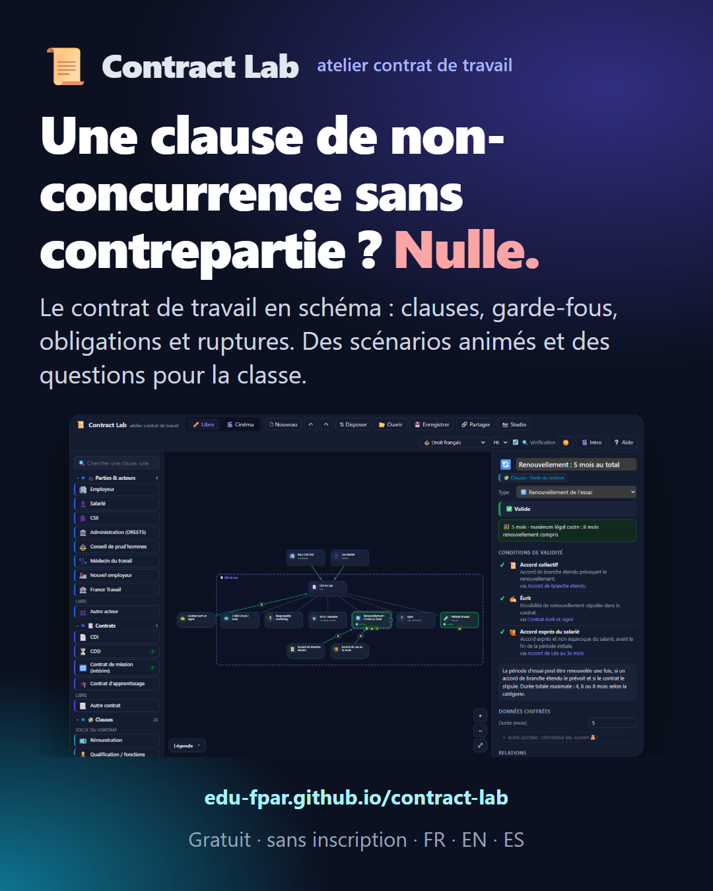 | 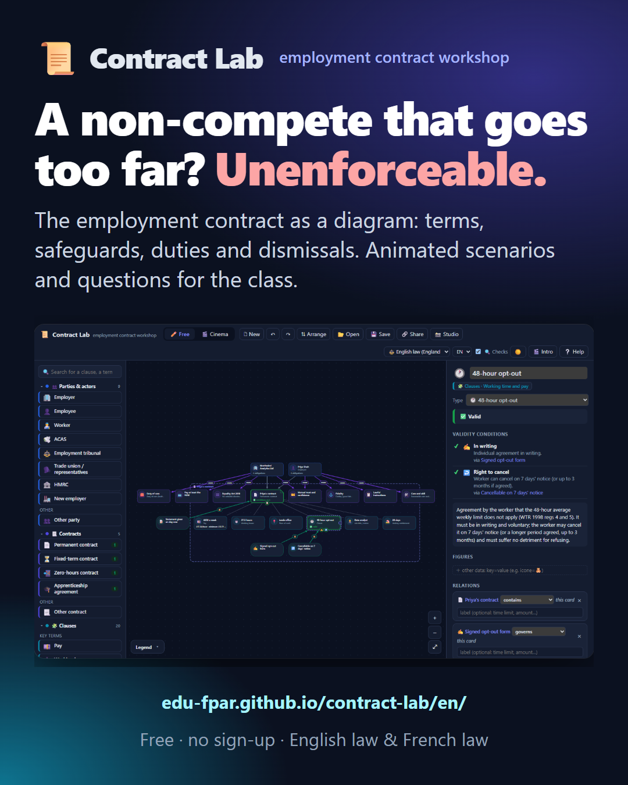 | 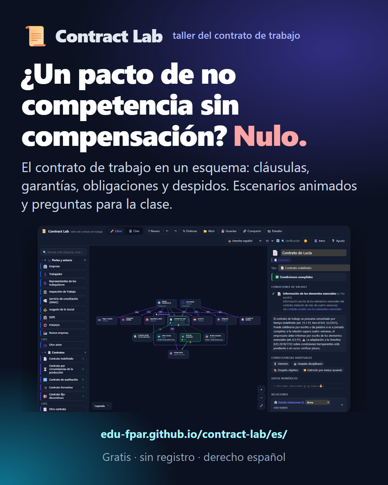 |
| story | 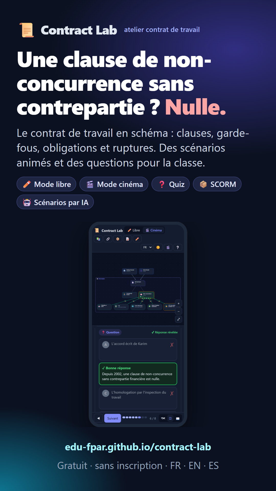 | 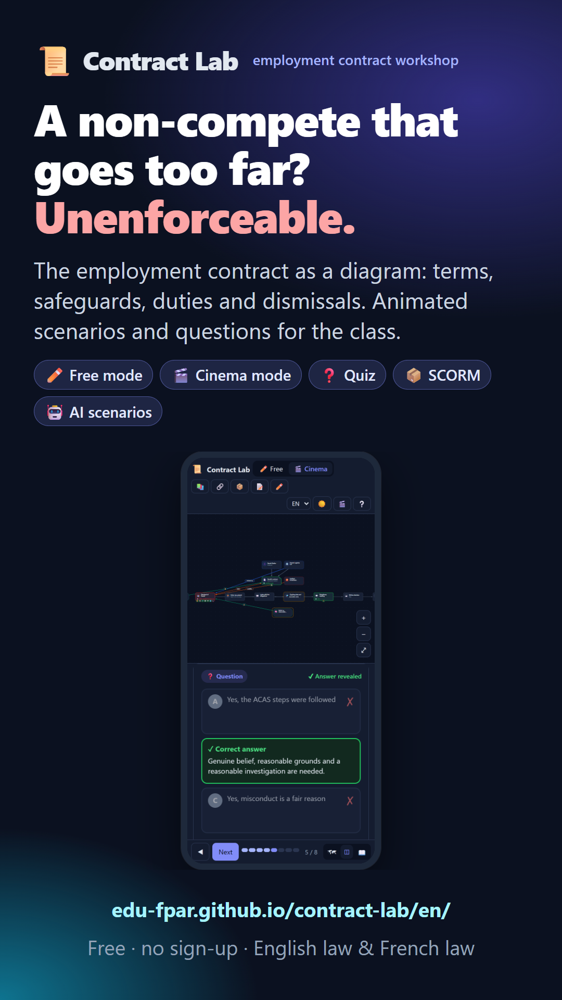 | 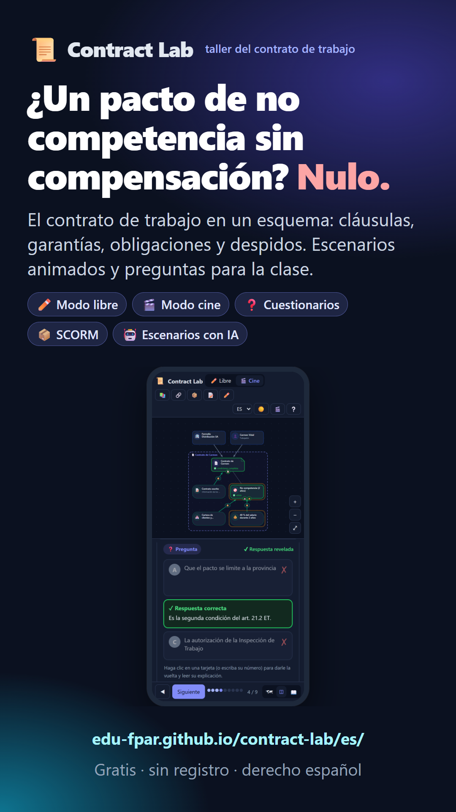 |

## Textes prêts à poster

### Français

> **Une clause de non-concurrence sans contrepartie ? Nulle.**
> Contract Lab transforme un cours de droit du travail en schéma : un contrat et ses clauses en icônes, les garde-fous qui les rendent valables, les obligations des parties, les ruptures et leur procédure. Mode libre pour construire, mode cinéma pour dérouler des scénarios animés avec des questions à la salle, quiz, export SCORM pour Moodle, et des scénarios générés par IA.
> Gratuit, sans inscription, en français, anglais et espagnol : https://edu-fpar.github.io/contract-lab/
> #DroitDuTravail #Pédagogie #EnseignementSupérieur #BTS #EdTech #OpenSource

Texte alternatif : *Contract Lab en mode cinéma : une clause de non-concurrence, ses cinq garde-fous, et la question posée à la salle avec la réponse révélée.*

### English

> **A non-compete that goes too far? Unenforceable.**
> Contract Lab turns an employment law class into a diagram: a contract and its terms as icons, the safeguards that make them enforceable, the duties of each party, dismissals and their procedure. Free mode to build, cinema mode to play animated scenarios with questions for the class, quizzes, SCORM export for Moodle, and AI-generated scenarios. English law and French law.
> Free, no sign-up: https://edu-fpar.github.io/contract-lab/en/
> #EmploymentLaw #LegalEducation #HigherEd #EdTech #OpenSource

Alt text: *Contract Lab in cinema mode, English law: a non-compete and its safeguards, with the question put to the class and the answer revealed.*

### Español

> **¿Un pacto de no competencia sin compensación? Nulo.**
> Contract Lab convierte una clase de derecho del trabajo en un esquema: el contrato y sus cláusulas en iconos, las garantías que las hacen válidas, las obligaciones de las partes, los despidos y su procedimiento. Modo libre para construir, modo cine para reproducir escenarios animados con preguntas a la clase, cuestionarios, exportación SCORM para Moodle y escenarios generados con IA. Derecho español.
> Gratis y sin registro: https://edu-fpar.github.io/contract-lab/es/
> #DerechoLaboral #DerechoDelTrabajo #Docencia #FP #EdTech #CódigoAbierto

Texto alternativo: *Contract Lab en modo cine, derecho español: un pacto de no competencia y sus garantías, con la pregunta a la clase y la respuesta revelada.*
